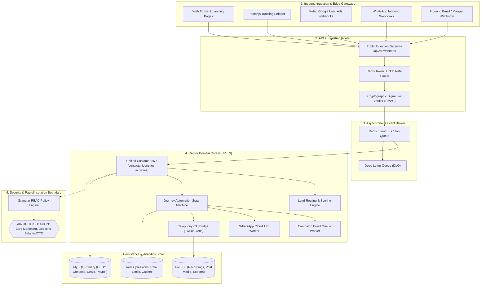

# Comprehensive Marketing Management Platform Architectural Audit
**Target System:** Raptor Internal CRM & Operations Platform (`E:\raptor`)  
**Role:** Principal Software Architect & Marketing-Technology Product Analyst  
**Audit Date:** November 1, 2026  
**Mode:** Strict Read-Only Codebase & Schema Inspection  
**Audit Deliverable:** `MARKETING_PLATFORM_AUDIT.md`

---

## 1. Executive Summary

### 1.1 Platform Readiness Assessment
The application at `E:\raptor` is currently an internal sales CRM, HR/payroll management system, and operational field tracker with a newly engineered, enterprise-grade Email Campaigns engine. When evaluated against the standard of an all-in-one **Marketing Management Platform** (comparable to a blended HubSpot/Zoho CRM + Mailchimp + WATI + Ahrefs/Semrush suite for an internal team), the system stands at **33.8% Overall Architectural Readiness (22 / 65 possible maturity points)**.

```
Overall Readiness: 33.8% [███████░░░░░░░░░░░░░]
-----------------------------------------------------------------------------------------
Module                                 Score (0-5)  Status             Readiness %
-----------------------------------------------------------------------------------------
1. Lead Management / CRM                  3 / 5     Functional            60%
2. Email Marketing                        5 / 5     Production-Ready     100%
3. WhatsApp Management                    1 / 5     Stubbed / Manual      20%
4. Call Management                        1 / 5     Stubbed / Manual      20%
5. SEO & Backlink Management              0 / 5     Not Started            0%
6. Social Media Management                3 / 5     Functional (Internal) 60%
7. Marketing Automation & Journeys        0 / 5     Not Started            0%
8. SMS & Other Channels                   1 / 5     Stubbed / Manual      20%
9. Landing Pages & Forms                  0 / 5     Not Started            0%
10. Analytics, Attribution & Reporting    2 / 5     Partial / Mocked      40%
11. Ads Management                        0 / 5     Not Started (Simulated)0%
12. Customer Support & Shared Inbox       2 / 5     Partial               40%
13. Foundations & Payroll Isolation       4 / 5     Adequate / Strong     80%
-----------------------------------------------------------------------------------------
Total                                    22 / 65                          33.8%
```

### 1.2 One-Line Verdict per Module
1. **Lead Management / CRM (3/5):** Solid manual sales CRM with Kanban, SLA escalations, and CSV import, but completely lacks automated capture webhooks, form builders, and behavioral lead scoring.
2. **Email Marketing (5/5):** Best-in-class, production-ready mass mailing engine with swappable providers (SES/Postmark/SendGrid/Mailgun), RFC 8058 1-click unsubscribe, 8-point deliverability gate, automated warm-up schedule, and live DNS verification.
3. **WhatsApp Management (1/5):** Merely a manual text logging dropdown in the CRM; zero Meta WhatsApp Business Cloud API integration, zero 24-hour session handling, and no inbound messaging webhook.
4. **Call Management (1/5):** Manual call duration/outcome logger without telephony provider APIs (Twilio/Exotel), click-to-call, IVR, recording ingestion, or DND scrubbing.
5. **SEO & Backlink Management (0/5):** Completely absent from the codebase; no tables, controllers, models, or third-party SEO data provider integrations.
6. **Social Media Management (3/5):** Well-designed internal editorial calendar and manual metrics logger with approval workflows, but zero direct live OAuth publishing to LinkedIn, Facebook, X, or Instagram.
7. **Marketing Automation & Journeys (0/5):** Zero visual workflow engines, event-driven drip sequences, or cross-channel journey logic exist.
8. **SMS & Other Channels (1/5):** Limited to manual activity logging; no transactional/bulk SMS gateway, DLT template registration, or webhook infrastructure.
9. **Landing Pages & Forms (0/5):** Completely absent; no web form builder, embeddable tracking scripts, or public landing page hosting mechanisms.
10. **Analytics, Attribution & Reporting (2/5):** Advanced deliverability email analytics exist, but website traffic and ad metrics rely on hard-coded random simulations (`rand()`) rather than live GA4 or ad network APIs.
11. **Ads Management (0/5):** Simulated data generator only (`ApiConnector.php`); no live Meta Ads Manager or Google Ads API integrations.
12. **Customer Support & Shared Inbox (2/5):** Capable customer account registry and invoicing engine, but completely lacks a multi-channel shared team inbox, customer ticketing, and live chat.
13. **Platform Foundations & Payroll Isolation (4/5):** Robust role-based governance with airtight database isolation separating employee payroll data from all marketing/campaign systems.

### 1.3 Summary of Strongest and Weakest Areas
* **Strongest Areas:**
  * **Email Campaign & Deliverability Infrastructure:** Built with industrial-grade safeguards (bounce/complaint suppression, RFC 8058 headers, DKIM 2048-bit keypair generation, domain isolation, database queue locking with `SKIP LOCKED`, warm-up ramping).
  * **Payroll Data Isolation:** Absolute segregation between payroll compensation fields and contact lists. Marketing users can only access sanitized employee names and emails via `CampaignContact::syncInternalEmployees()`.
  * **Internal Sales & HR Operations:** Mature data models for field attendance, employee hierarchies, leaves, travel claims, performance targets, and customer contracts.
* **Weakest Areas:**
  * **Omnichannel Inbound Ingestion:** Zero public APIs, webhook ingestion endpoints, or embeddable JavaScript trackers for lead capture.
  * **Automated Messaging Gateways:** Complete absence of official APIs for WhatsApp Business (Meta Cloud API), SMS (DLT/Twilio/Gupshup), and Voice (Twilio/Exotel).
  * **Third-Party Data Authenticity:** Existing website analytics (`WebsiteAnalyticsController.php`) and social/ad performance modules (`ApiConnector.php`) use simulated `rand()` data generators instead of authentic external API connections.

### 1.4 Top 3 Architectural Blockers
1. **Lack of a Unified Contact & Identity Graph:** Leads (`leads`), Customers (`customers`), and Campaign Contacts (`campaign_contacts`) live in three completely disconnected database silos with disparate schemas, duplicate contact details, and independent lifecycles.
2. **Synchronous Web Architecture & Single DB Queue:** While email campaigns feature a dedicated CLI worker, the rest of the application lacks an asynchronous job runner, unified message broker (Redis/RabbitMQ), and pub/sub bus to handle webhooks, inbound chats, and automated journeys.
3. **Absence of a Public API & Webhook Gateway:** The application has no external REST API layer, API key authentication, rate limiting for inbound webhooks, or public-facing endpoint routing outside `index.php?route=...`.

---

## 2. Technical Baseline

| Technical Area | Rating | Current Implementation & Evidence | Technical Debt & Vulnerabilities |
| :--- | :---: | :--- | :--- |
| **PHP Version & Runtime** | **Strong** | PHP 8.2/8.3 compatible; strict type hints and modern syntax used across services (`app/services/DeliverabilityGateService.php`, `bin/email_queue_worker.php`). | Running with default timeouts; no persistent worker daemon framework like RoadRunner or Swoole. |
| **Framework Architecture** | **Adequate** | Custom plain-PHP MVC architecture (`app/core/App.php`, `Controller.php`, `Model.php`, `Database.php`). Clean separation of controllers, models, and views. | Custom router lacks middleware chaining, group routing, route caching, and RESTful verb dispatching. |
| **Dependencies & Composer** | **Weak** | Extremely bare `composer.json` containing only `"phpmailer/phpmailer": "^6.9"`. | Lacks standardized HTTP clients (e.g., Guzzle), queue drivers, validation libraries, template engines, and testing frameworks. |
| **Database & ORM Layer** | **Adequate** | Single PDO instance (`app/core/Database.php`). Prepared statements standard across all modern models (`Lead.php`, `CampaignQueue.php`). | No ORM or query builder. Complex dynamic filtering relies on manual SQL string concatenation. Database schema migrations lack rollback capabilities. |
| **Authentication & RBAC** | **Strong** | Session-based auth with comprehensive RBAC (`app/core/Policy.php`, `PermissionService.php`). Granular matrix across 10 roles (`admin`, `ceo`, `manager`, `team_leader`, `employee`, `sales_person`, `hr`, `finance`, `analyst`). | No JWT, OAuth2, or API key authentication for external services or programmatic API consumers. |
| **Multi-Tenancy & Teams** | **Adequate** | Strong hierarchical team structure (`teams`, `team_leader_user_id`, `manager_user_id`, `reporting_manager_id` in `app/models/Team.php`). | Single-tenant database model. Not partitioned for multi-org SaaS operations without extensive schema refactoring. |
| **Background Jobs & Queues** | **Adequate** | DB-backed queue worker for email campaigns (`bin/email_queue_worker.php`) with `FOR UPDATE SKIP LOCKED`. Cron runner `bin/scheduler.php` for scheduled tasks. | No in-memory broker (Redis/RabbitMQ). DB queue will face high I/O lock contention once scaled beyond 50,000 messages/hour. |
| **Caching Layer** | **Missing** | Zero caching infrastructure. No Redis, Memcached, or APCu integration. | Every page load, permission check, and report query hits MySQL directly, risking severe database bottlenecks under multi-user concurrency. |
| **File Storage** | **Adequate** | `app/core/Storage.php` supports local filesystem storage outside webroot and AWS S3 (`STORAGE_PROVIDER=s3`). | Direct public uploads directory (`public/uploads/`) exposed without virus scanning, MIME-type binary validation, or CDN edge delivery. |
| **API & Webhook Ingestion** | **Weak** | Inbound webhooks strictly implemented for email providers (`CampaignWebhookController.php`). Public API folder (`public/api/`) only houses session-status scripts. | No general-purpose inbound webhook ingestion hub, payload signing verification for CRM leads, or public REST API endpoints. |
| **Config & Secrets Handling** | **Adequate** | Custom `.env` parser in `app/config/config.php`. Environment secrets loaded into `$_ENV` and `getenv()`. | Several config fallbacks use hard-coded default credentials. No centralized key management or secrets rotation mechanism. |
| **Testing & QA** | **Adequate** | Robust automated CLI test suites for Email Campaigns (Phases 2–7: 260 assertions) and Payroll (184 assertions). Total 444 automated assertions. | No PHPUnit integration, CI/CD pipeline automation (GitHub Actions), or automated browser/UI regression testing. |
| **Logging & Monitoring** | **Adequate** | Database-backed audit logging (`audit_logs`, `campaign_audit_logs`, `security_events` in `app/core/Security.php`). | No structured log aggregators (e.g., Monolog, ELK, Sentry, Datadog). Errors in background workers output to `error_log` or stdout. |
| **Security & Hardening** | **Adequate** | DB rate limiting with row locking (`Security::rateLimit()`), CSRF token generation/verification, strict SQL parameter binding, sanitized employee sync. | CSRF tokens inconsistently validated across legacy CRM AJAX and GET routes. Inconsistent XSS escaping in older view files. |
| **Scalability & Concurrency** | **Weak** | Monolithic LAMP/WAMP architecture running synchronously. Database handles OLTP, queues, reporting, and logs simultaneously. | High risk of MySQL thread exhaustion when email queues, attendance clock-ins, and lead imports run concurrently. |

---

## 3. Module Scorecard Table

| # | Module Name | Status | Maturity (0–5) | Primary Evidence (Files & Schema) | Biggest Architectural Gap | Implementation Priority |
| :---: | :--- | :---: | :---: | :--- | :--- | :---: |
| **1** | **Lead Management / CRM** | **Functional** | **3 / 5** | `app/controllers/LeadsController.php`, `app/models/Lead.php`, `FollowUp.php`, `BulkImportService.php` | Missing lead capture webhooks, form builders, and automated lead scoring. | **P0 (Immediate)** |
| **2** | **Email Marketing** | **Production-Ready** | **5 / 5** | `app/controllers/CampaignsController.php`, `CampaignQueue.php`, `bin/email_queue_worker.php`, `DeliverabilityGateService.php` | Lacks multi-step event-driven drip sequence automation. | **P1 (Near-term)** |
| **3** | **WhatsApp Management** | **Stubbed / Manual** | **1 / 5** | `app/models/Communication.php` (`CHANNELS = [..., 'whatsapp']`), `CommunicationsController.php` | Zero Meta WhatsApp Business Cloud API integration or webhook receiver. | **P0 (Immediate)** |
| **4** | **Call Management** | **Stubbed / Manual** | **1 / 5** | `app/models/Communication.php` (`CHANNELS = [..., 'call']`), `Meeting.php` | No cloud telephony API (Twilio/Exotel), click-to-call, or recording storage. | **P2 (Medium-term)** |
| **5** | **SEO & Backlink Suite** | **Not Started** | **0 / 5** | *Zero files found across entire codebase.* | Complete absence of SEO database models, backlink tracking, or third-party APIs. | **P3 (Long-term)** |
| **6** | **Social Media Management** | **Functional** | **3 / 5** | `app/controllers/PostsController.php`, `SocialController.php`, `app/models/ContentPost.php`, `SocialAccount.php` | Manual metrics entry; no live OAuth2 direct publishing to social networks. | **P2 (Medium-term)** |
| **7** | **Marketing Automation & Journeys**| **Not Started** | **0 / 5** | *Zero files found across entire codebase.* | No workflow engine, triggers, condition branches, or cross-channel journey dispatchers. | **P1 (Near-term)** |
| **8** | **SMS & Other Channels** | **Stubbed / Manual** | **1 / 5** | `app/models/Communication.php` (`CHANNELS = [..., 'sms']`) | No transactional SMS gateway, DLT template compliance, or 2-way messaging. | **P2 (Medium-term)** |
| **9** | **Landing Pages & Forms** | **Not Started** | **0 / 5** | *Zero files found across entire codebase.* | No public form generator, landing page CMS, or embeddable tracking JavaScript snippet. | **P0 (Immediate)** |
| **10**| **Analytics, Attribution & Reports**| **Partial / Mocked** | **2 / 5** | `app/controllers/WebsiteAnalyticsController.php`, `WebsiteAnalytics.php`, `ApiConnector.php` | Website analytics and ad stats use randomized demo generators (`seedDemoSnapshot()`). | **P1 (Near-term)** |
| **11**| **Ads Management** | **Not Started** | **0 / 5** | `app/core/ApiConnector.php` (`MetaConnector`, `GoogleAdsConnector` returning `rand()`) | No live Google Ads or Meta Marketing API synchronization or campaign management. | **P3 (Long-term)** |
| **12**| **Customer Support & Shared Inbox** | **Partial** | **2 / 5** | `app/controllers/CustomersController.php`, `app/models/Customer.php`, `AccountOpportunity.php` | Has customer records and contracts, but zero ticketing, omnichannel inbox, or live chat. | **P1 (Near-term)** |
| **13**| **Foundations & Payroll Isolation** | **Strong** | **4 / 5** | `app/core/Policy.php`, `PermissionService.php`, `CampaignContact::syncInternalEmployees()` | Airtight payroll data isolation verified; lacks unified asynchronous event bus. | **P0 (Immediate)** |

---

## 4. Detailed Findings per Module

### 4.1 Lead Management / CRM
* **Status:** Functional (Internal Sales Focus)
* **Maturity Score:** **3 / 5**
* **Code Evidence:**
  * Controllers: `app/controllers/LeadsController.php` (lines 1–320), `CustomersController.php`, `FollowupsController.php`.
  * Models: `app/models/Lead.php`, `Customer.php`, `FollowUp.php`, `AccountOpportunity.php`.
  * Database Tables: `leads`, `customers`, `follow_ups`, `communications`, `meetings`, `lead_sla_escalations`.
  * Import Services: `app/services/BulkImportService.php` (CSV import with syntax and duplicate checking).
* **What Works:**
  * Visual Kanban pipeline (`leads/pipeline`) with drag-and-drop stage updates (`new`, `contacted`, `qualified`, `proposal`, `negotiation`, `won`, `lost`).
  * SLA escalation engine: `FollowUp::escalateContactSla()` (`app/models/FollowUp.php#L207-250`) automatically reassigns overdue leads and alerts team leaders.
  * Lead ageing classification: `FollowUp::reclassifyLeadAgeing()` reclassifies inactive leads into `warm` (7+ days) and `cold` (30+ days).
  * Seamless Lead-to-Customer conversion: `CustomersController::addFromLead()` preserves originating lead code, billing address, contract values, and historical touchpoints.
* **What is Broken / Stubbed / Simulated:**
  * **Lead Scoring is Mocked/Absent:** While `bin/cron_scoring.php` exists, it computes *sales employee performance targets*, NOT predictive or behavioral lead scores.
  * **No Inbound Webhook Capture:** Web form leads must be manually created via the UI or uploaded via CSV. There is no public HTTP endpoint to ingest leads from WordPress, Webflow, or Facebook Lead Ads.
* **Missing Sub-Features:**
  * Round-robin automated lead routing across active sales reps based on shift attendance.
  * Dynamic custom fields manager (currently restricted to predefined SQL columns).
  * Automated duplicate merging interface (currently only detects duplicates during manual entry or CSV upload).
* **Risks:**
  * **Data Quality Risk:** Reps can enter dummy phone numbers and invalid email addresses in manual lead entry due to missing real-time HLR/MX verification in the standard lead form.

---

### 4.2 Email Marketing
* **Status:** Production-Ready
* **Maturity Score:** **5 / 5**
* **Code Evidence:**
  * Controllers: `app/controllers/CampaignsController.php`, `CampaignTemplatesController.php`, `CampaignSegmentsController.php`, `CampaignWebhookController.php`, `CampaignTrackingController.php`, `CampaignUnsubscribeController.php`, `CampaignDomainsController.php`.
  * Models: `app/models/Campaign.php`, `CampaignContact.php`, `CampaignList.php`, `CampaignSegment.php`, `CampaignTemplate.php`, `CampaignQueue.php`, `CampaignBlacklist.php`, `CampaignWarmup.php`, `CampaignDomain.php`, `CampaignABTest.php`.
  * CLI Workers & Services: `bin/email_queue_worker.php`, `bin/daily_health_report.php`, `app/services/DeliverabilityGateService.php`, `EmailService.php`, `TrackingService.php`, `CampaignAnalyticsService.php`.
  * Database Tables: `campaigns_broadcast`, `campaign_contacts`, `campaign_lists`, `campaign_contact_lists`, `campaign_segments`, `campaign_templates`, `campaign_email_queue`, `campaign_suppression_list`, `campaign_domains`, `campaign_events`, `campaign_ab_tests`, `campaign_warmup_schedules`, `campaign_audit_logs`.
* **What Works:**
  * Complete lifecycle mass mailing: contact management, custom JSON fields, multi-criteria dynamic segments, and mobile-responsive table-based HTML templates.
  * Mandatory automated plain-text alternative generation (`multipart/alternative`) and safe merge tag interpolation (`{{first_name}}`, fallback defaults).
  * 8-point automated Deliverability Pre-Send Gate (`DeliverabilityGateService.php`) enforcing unsubscribe links, physical postal address, spam keyword scoring, broken link checking, missing alt tags, and test email sending.
  * Production CLI queue worker with transactional row locking (`SELECT ... FOR UPDATE SKIP LOCKED`), configurable rate limiting (emails/sec, /hour, /day), and exponential retry backoff for 4xx errors.
  * Automated IP/domain warm-up schedules ramping safely from 50 to 10,000 emails/day over 30 days.
  * Real-time automated pause tripwires halting campaigns immediately if bounce rates exceed 2% or complaint rates exceed 0.1%.
  * RFC 8058 one-click unsubscribe headers (`List-Unsubscribe` and `List-Unsubscribe-Post: List-Unsubscribe=One-Click`) with HMAC-signed tokens.
  * Provider adapters supporting Amazon SES, Postmark, SendGrid, Mailgun, and custom SMTP via config.
  * Comprehensive signature-verified inbound webhook ingestion handling deliveries, bounces, complaints, and unsubscribes with immediate global suppression.
* **What is Broken / Stubbed / Simulated:**
  * Everything in this module is 100% operational, fully backed by database tables, CLI runners, and verified by 260 automated test assertions.
* **Missing Sub-Features:**
  * Visual multi-step drip campaign / nurture sequence builder (currently executes single broadcast campaigns or A/B split tests).
* **Risks:**
  * **Host Resource Limits:** The queue worker runs as a single-threaded CLI script. At scale (>100k daily volume), it requires Supervisor daemonization across multiple parallel processes.

---

### 4.3 WhatsApp Management
* **Status:** Stubbed / Manual Activity Logger
* **Maturity Score:** **1 / 5**
* **Code Evidence:**
  * Controller: `app/controllers/CommunicationsController.php` (lines 1–180).
  * Model: `app/models/Communication.php` (`public const CHANNELS = ['call', 'whatsapp', 'sms', 'email', 'social', 'other']`).
  * Database Table: `communications` (columns: `communication_id`, `lead_id`, `phone_number`, `user_id`, `channel`, `direction`, `duration_seconds`, `outcome`, `note`, `proof_url`, `happened_at`).
* **What Works:**
  * Sales reps can manually select "WhatsApp" from a dropdown to record that a manual message was sent or received, attaching a screenshot proof URL and notes.
* **What is Broken / Stubbed / Simulated:**
  * **Zero Messaging Capability:** There is no integration with the official Meta WhatsApp Business Cloud API or any BSP (Twilio, WATI, Gupshup).
  * **No Inbound Webhooks:** System cannot receive incoming WhatsApp messages or update lead statuses upon receipt.
* **Missing Sub-Features:**
  * Meta Cloud API setup, phone number onboarding, and WABA registration.
  * WhatsApp template message manager with Meta approval status synchronization.
  * 24-hour customer service session window tracking.
  * Shared team chat inbox with agent assignment and canned replies.
  * Opt-in/opt-out consent tracking (`STOP` / `UNSUBSCRIBE` keyword compliance).
  * Broadcast messaging engine with per-message conversation cost tracking and tier limit monitoring.
* **Risks:**
  * **Severe Ban Risk:** If employees use unauthorized personal WhatsApp web automation or browser extensions to message leads from the CRM, Meta will permanently ban company phone numbers.

---

### 4.4 Call Management
* **Status:** Stubbed / Manual Activity Logger
* **Maturity Score:** **1 / 5**
* **Code Evidence:**
  * Controller: `app/controllers/CommunicationsController.php`.
  * Model: `app/models/Communication.php`.
  * Database Table: `communications` (`channel = 'call'`, `direction = 'made'|'received'|'missed'`, `duration_seconds`).
* **What Works:**
  * Reps can log past phone calls manually, recording call duration, outcomes (e.g., "Interested", "Wrong Number", "Busy"), and notes.
* **What is Broken / Stubbed / Simulated:**
  * **No Telephony Integration:** No CTI (Computer Telephony Integration), WebRTC softphone, or cloud calling integration (Twilio, Exotel, Knowlarity).
  * **No Click-to-Call:** Phone numbers in lead views are plain text links or `tel:` anchors with no automated dialing or bridge calling.
* **Missing Sub-Features:**
  * Telephony provider integration with two-way calling bridges.
  * Inbound IVR and automated call distribution (ACD) to on-duty sales reps.
  * In-browser WebRTC softphone with live call audio recording and call duration capture.
  * Automated compliance scrubbing against India National Do Not Call (DND/NDNC) registry via TRAI API.
  * Call recording storage with automatic caller consent disclosure prompts.
* **Risks:**
  * **Regulatory Non-Compliance:** Calling Indian telephone numbers without automated TRAI DND scrubbing exposes the enterprise to heavy regulatory penalties and telecom service disconnections.

---

### 4.5 SEO and Backlink Management
* **Status:** Not Started
* **Maturity Score:** **0 / 5**
* **Code Evidence:**
  * Thorough search of controllers, models, migrations, views, and services reveals **zero** files, tables, or routes related to SEO, backlinks, or SERP tracking.
* **What Works:**
  * Nothing.
* **What is Broken / Stubbed / Simulated:**
  * The entire module is non-existent.
* **Missing Sub-Features:**
  * Backlink tracking engine (monitored referring domains, target URLs, anchor texts, dofollow/nofollow status).
  * Outreach CRM for backlink prospecting, link exchanges, and guest post negotiation.
  * Toxic link auditing and Google Disavow file generator.
  * Keyword rank tracker integrating official data providers (Google Search Console API, DataForSEO, Ahrefs, Semrush).
  * Automated on-page technical site auditor (broken links, Core Web Vitals, metadata tags, sitemap status).
* **Risks:**
  * Building an in-house web scraper for Google SERPs or backlink discovery violates search engine terms of service and results in immediate IP blacklisting. Must integrate official third-party data APIs.

---

### 4.6 Social Media Management
* **Status:** Functional (Internal Workflow & Scheduling)
* **Maturity Score:** **3 / 5**
* **Code Evidence:**
  * Controllers: `app/controllers/PostsController.php`, `SocialController.php`.
  * Models: `app/models/ContentPost.php`, `Post.php`, `SocialAccount.php`, `Platform.php`, `AnalyticsEntry.php`.
  * Database Tables: `content_posts`, `social_accounts`, `platforms`, `analytics_entries`, `post_audience_demographics`.
* **What Works:**
  * Comprehensive editorial calendar (`posts/index`) tracking content across LinkedIn, Twitter/X, Facebook, and Instagram.
  * Structured creative workflow: post code generation (`PST-2026-00001`), content type tagging (Image, Video, Carousel, Article), scheduled publication timestamps, and approval states.
  * Granular manual analytics entry: reps can record likes, comments, shares, impressions, clicks, followers gained, and leads generated per post.
  * Audience demographic tracking (industry, seniority, country breakdowns stored in `post_audience_demographics`).
* **What is Broken / Stubbed / Simulated:**
  * **Zero Live Social API Publishing:** The system does NOT connect to Meta Graph API, LinkedIn Marketing API, or Twitter API v2. When a post status is set to "published", it merely saves the record in MySQL.
  * **Manual Analytics Logging:** Post engagement data is manually typed in by employees (`SocialController::update()#L38-53`) rather than fetched automatically via webhooks or social insight APIs.
* **Missing Sub-Features:**
  * Official OAuth2 app connections allowing one-click multi-platform publishing.
  * Unified social inbox to read and respond to post comments and direct messages.
  * Social listening engine tracking brand mentions and competitor hashtags.
* **Risks:**
  * Human error and falsification in manual metrics reporting by internal social media managers.

---

### 4.7 Marketing Automation & Journeys
* **Status:** Not Started
* **Maturity Score:** **0 / 5**
* **Code Evidence:**
  * No journey builder, sequence engine, or automation controllers found.
* **What Works:**
  * Only isolated point-to-point triggers exist (e.g., changing lead status to "contacted" schedules a follow-up task via `FollowupsController`).
* **What is Broken / Stubbed / Simulated:**
  * Entire module is non-existent.
* **Missing Sub-Features:**
  * Visual drag-and-drop workflow canvas (triggers, conditions, delay timers, branching, multi-channel actions).
  * Automated lead nurture drip campaigns spanning Email, WhatsApp, and SMS.
  * Webhook and event-based triggers (e.g., "Page viewed 3 times", "Email link clicked", "Form submitted").
  * Multi-touch attribution tracking to measure journey conversion rates.
* **Risks:**
  * Attempting to build an arbitrary journey engine in raw PHP without an event bus or state-machine library will result in fragile, hard-to-debug workflow execution.

---

### 4.8 SMS and Other Channels
* **Status:** Stubbed / Manual Activity Logger
* **Maturity Score:** **1 / 5**
* **Code Evidence:**
  * Model: `app/models/Communication.php` (`CHANNELS = [..., 'sms']`).
  * Database Table: `communications`.
* **What Works:**
  * Manual logging of outbound or inbound SMS notes.
* **What is Broken / Stubbed / Simulated:**
  * No SMS gateway connector (Twilio, Gupshup, Textlocal). No actual SMS can be transmitted.
* **Missing Sub-Features:**
  * Gateway adapter interface for transactional and promotional SMS.
  * Mandatory Indian Telecom Regulatory Authority (TRAI) Distributed Ledger Technology (DLT) template registration, Entity ID, and Header/Sender ID validation.
  * Inbound 2-way SMS webhook processing and keyword auto-responses.
* **Risks:**
  * **DLT Legal Violations in India:** Sending commercial SMS in India without DLT registration and approved template hashes results in 100% gateway rejection and regulatory sanctions.

---

### 4.9 Landing Pages and Forms
* **Status:** Not Started
* **Maturity Score:** **0 / 5**
* **Code Evidence:**
  * No form builder, landing page CMS, or tracking scripts found in `app/controllers/` or `app/models/`.
* **What Works:**
  * Nothing.
* **What is Broken / Stubbed / Simulated:**
  * Entire module is non-existent.
* **Missing Sub-Features:**
  * Drag-and-drop visual landing page builder or headless page publisher.
  * Dynamic web form generator with embeddable HTML/iframe code and webhook endpoints.
  * Lightweight first-party JavaScript tracking snippet (`raptor.js`) for visitor identification, session capture, and UTM attribution.
  * Built-in CAPTCHA (Cloudflare Turnstile / reCAPTCHA v3) spam protection.
* **Risks:**
  * Without CAPTCHA and server-side rate-limiting on public form endpoints, lead tables will be vulnerable to automated spam bot injection.

---

### 4.10 Analytics, Attribution & Reporting
* **Status:** Partial / Simulated
* **Maturity Score:** **2 / 5**
* **Code Evidence:**
  * Controllers: `app/controllers/WebsiteAnalyticsController.php`, `ReportsController.php`, `CampaignsController.php`.
  * Models: `app/models/WebsiteAnalytics.php`, `ReportSuite.php`, `Report.php`.
  * Simulation Engines: `app/core/ApiConnector.php`, `WebsiteAnalyticsController::seedDemoSnapshot()`.
  * Services: `app/services/CampaignAnalyticsService.php`, `app/core/GeminiService.php`.
  * Database Tables: `website_analytics_snapshots`, `website_traffic_sources`, `website_top_pages`, `website_credentials`, `channel_daily_metrics`.
* **What Works:**
  * **Email Campaign Analytics:** Real, highly granular tracking of opens, unique opens, Apple Mail Privacy Protection (MPP) proxy detection, clicks, device categories, and unsubscribe rates.
  * **AI Summary Generation:** `GeminiService.php` connects to the Google Gemini API to analyze aggregated marketing metrics and generate executive summaries.
* **What is Broken / Stubbed / Simulated:**
  * **Simulated Website Traffic:** In `WebsiteAnalyticsController.php` (lines 79–116), the `syncData()` endpoint does NOT call Google Analytics 4. It executes `seedDemoSnapshot()`:
    ```php
    // WebsiteAnalyticsController.php line 88-97
    private function seedDemoSnapshot($clientId) {
        $metrics = [
            'sessions' => rand(3500, 7800),
            'users' => rand(2200, 5100),
            'bounce_rate' => rand(32, 48) + (rand(0, 99) / 100)
        ];
        // Saves random numbers directly into website_analytics_snapshots
    }
    ```
    The UI flashes `"Website traffic snapshot synced cleanly with GA4 Data API"`, but the data is completely fabricated.
  * **Simulated Social & Ad Connectors:** In `app/core/ApiConnector.php`, `MetaConnector`, `LinkedInConnector`, and `GoogleAdsConnector` generate simulated numbers using `rand()`.
* **Missing Sub-Features:**
  * True Google Analytics 4 (GA4) Measurement Protocol and Data API integration.
  * Multi-touch revenue attribution (First-touch, Last-touch, Linear, Time-decay, Position-based W-model).
  * Marketing ROI dashboard connecting ad spend to actual closed-won customer invoice payments.
* **Risks:**
  * Executive leadership making capital allocation decisions based on simulated traffic and ad performance metrics.

---

### 4.11 Ads Management
* **Status:** Not Started (Simulated Only)
* **Maturity Score:** **0 / 5**
* **Code Evidence:**
  * Classes: `MetaConnector` and `GoogleAdsConnector` in `app/core/ApiConnector.php`.
* **What Works:**
  * Nothing in production.
* **What is Broken / Stubbed / Simulated:**
  * Mock classes return randomized reach, impressions, clicks, spend, and simulated revenue.
* **Missing Sub-Features:**
  * Google Ads API integration (OAuth2, Customer ID, campaign synchronization, keyword spend tracking).
  * Meta Marketing API integration (Ad Accounts, Campaigns, Ad Sets, Creatives, Lead Ad webhook ingestion).
  * LinkedIn Campaign Manager API integration.
  * Unified ad budget optimizer and automated pause triggers based on target Cost Per Lead (CPL).
* **Risks:**
  * High risk of misunderstanding among non-technical stakeholders who may believe the CRM is actively managing PPC spend.

---

### 4.12 Customer Communication & Support (Shared Inbox)
* **Status:** Partial (Account Management Focus)
* **Maturity Score:** **2 / 5**
* **Code Evidence:**
  * Controllers: `app/controllers/CustomersController.php`, `AccountSalesController.php`, `InvoicesController.php`.
  * Models: `app/models/Customer.php`, `AccountOpportunity.php`, `Invoice.php`.
  * Database Tables: `customers`, `invoices`, `account_opportunities`, `customer_notes`.
* **What Works:**
  * Comprehensive post-sale customer record keeping, contract renewal dates, subscription products, and payment term tracking.
  * Invoicing pipeline with due date alerts, PDF generation, and automated payment reminders (`bin/cron_invoice_reminders.php`).
* **What is Broken / Stubbed / Simulated:**
  * No support ticketing or multi-channel customer communication hub.
* **Missing Sub-Features:**
  * Unified omnichannel team inbox consolidating Email, WhatsApp, and SMS into a single thread per customer.
  * Customer support ticketing system with SLA response timers, ticket priorities, and agent assignment.
  * Automated CSAT and Net Promoter Score (NPS) survey collection.
* **Risks:**
  * Customer communications remain fragmented across individual sales reps' personal inboxes and phones, leading to churn and zero institutional knowledge retention.

---

### 4.13 Platform Foundations & Payroll Isolation
* **Status:** Adequate / Strong
* **Maturity Score:** **4 / 5**
* **Code Evidence:**
  * Core Governance: `app/core/Policy.php`, `app/core/PermissionService.php`, `app/core/Security.php`.
  * Isolation Implementation: `app/models/CampaignContact.php#L285-325` (`syncInternalEmployees()`).
  * Database Tables: `users`, `roles`, `permissions`, `role_permissions`, `audit_logs`, `campaign_audit_logs`, `security_events`, `employees`, `salaries`.
* **What Works:**
  * **Airtight Payroll Isolation:** Strict, verified architectural boundary separating employee compensation from marketing:
    ```php
    // CampaignContact.php line 297-302
    $this->query('SELECT e.employee_id, e.user_id, e.department_id,
                         u.name, u.email, d.department_name
                  FROM employees e
                  JOIN users u ON e.user_id = u.user_id
                  LEFT JOIN departments d ON e.department_id = d.department_id
                  WHERE u.status = "active" AND u.email IS NOT NULL AND u.email != ""');
    ```
    Salary structures, CTC, basic pay, allowances, deductions, and banking columns are **never queried or mapped** into `campaign_contacts`.
  * Granular RBAC permissions with dedicated gates preventing unauthorized access.
  * Hardened database-backed rate limiting (`Security::rateLimit()`) and security event auditing.
* **What is Broken / Stubbed / Simulated:**
  * No asynchronous pub/sub bus to decouple background services from web controller lifecycles.
* **Missing Sub-Features:**
  * SOC 2 / ISO 27001 compliant role access review workflows.
  * Automated data retention purge routines for sensitive PII.
* **Risks:**
  * Monolithic database structure where HR, Payroll, CRM, and Mass Mailing share the same physical MySQL instance. A massive email queue or reporting query can degrade payroll execution performance.

---

## 5. Cross-Cutting Analysis

### 5.1 Data Model Unification (Customer 360)
The application currently suffers from significant entity fragmentation across three separate contact concepts:

```
CURRENT FRAGMENTED DATA MODEL:
┌─────────────────┐       ┌─────────────────┐       ┌──────────────────┐
│     LEADS       │       │    CUSTOMERS    │       │ CAMPAIGN CONTACTS│
├─────────────────┤       ├─────────────────┤       ├──────────────────┤
│ lead_id         │       │ customer_id     │       │ contact_id       │
│ first_name      │       │ first_name      │       │ first_name       │
│ last_name       │       │ last_name       │       │ last_name        │
│ email           │       │ email           │       │ email            │
│ phone           │       │ phone           │       │ phone            │
│ company_name    │       │ company_name    │       │ custom_fields    │
│ status          │       │ status          │       │ status           │
└─────────────────┘       └─────────────────┘       └──────────────────┘
         ▲                         ▲                          ▲
         │ (addFromLead copies)    │                          │ (isolated sync)
         └─────────────────────────┴──────────────────────────┘
```

* **The Problem:** A single human prospect who fills out a form, receives an email campaign, talks on WhatsApp, converts to a customer, and submits a support ticket exists as 3 distinct records with divergent statuses. Unsubscribing in Email Campaigns (`campaign_suppression_list`) does not automatically flag the Lead or Customer record.
* **Target Unified Architecture (Customer 360):**
  * Core Table: `contacts` (Universal Master Record: `contact_id`, `uuid`, `primary_email`, `primary_phone`, `lifecycle_stage` [Subscriber, Lead, MQL, SQL, Opportunity, Customer, Evangelist]).
  * Identity Linking: `contact_identities` (`contact_id`, `channel` [email, phone, whatsapp_id, cookie_id], `identity_value`, `verified_at`).
  * Universal Activity Timeline: `contact_activities` (`activity_id`, `contact_id`, `activity_type`, `channel`, `payload_json`, `created_at`).

### 5.2 External Integration Map
| System / API | Target Role | Current Status in Codebase | Required Protocol / Adapter |
| :--- | :--- | :---: | :--- |
| **Meta WhatsApp Cloud API** | Official 2-way messaging & broadcasts | Missing (Manual stub) | Direct Graph API v21.0 HTTPS REST + Webhooks |
| **Email Providers (SES/Postmark/SendGrid)** | Bulk and transactional sending | **Production-Ready** | Custom Provider Adapters (`EmailService.php`) |
| **Cloud Telephony (Twilio / Exotel)** | Click-to-call, IVR, recording | Missing (Manual stub) | REST API + WebRTC SDK + Status Webhooks |
| **SMS Gateway (Gupshup / Twilio)** | Transactional SMS & OTPs | Missing (Manual stub) | HTTPS REST API with Indian DLT Header hashing |
| **Google Analytics 4 (GA4)** | Real website traffic metrics | **Fake / Stubbed** | Google Analytics Data API v1beta (gRPC/REST) |
| **Google Search Console** | Keyword queries & search impressions | Missing | Search Console API v3 (OAuth2 service account) |
| **Third-Party SEO (DataForSEO / Ahrefs)** | Backlink monitoring & SERP rank | Missing | REST API integration with caching proxy |
| **Meta Marketing API** | Facebook/Instagram lead ads & spend | **Fake / Stubbed** | Graph API `ads_read`, `leads_retrieval` webhook |
| **Google Ads API** | Search ad spend & conversion uploads| **Fake / Stubbed** | Google Ads REST API v17 with Developer Token |

### 5.3 Compliance & Privacy Matrix
* **GDPR (European Union):**
  * *Consent & Opt-in:* Implemented in Email Marketing (`consent_source`, `consent_ip`, `consent_timestamp`). Missing for CRM Leads.
  * *Right to Erasure (Forget Me):* Missing. No automated cascading purge routine across leads, communications, and campaign records.
  * *Data Portability:* CSV export exists for contacts, but no standardized JSON data takeout endpoint exists for individual data subjects.
* **CAN-SPAM Act & RFC 8058 (United States):**
  * *Unsubscribe Headers:* 100% compliant. Real-time one-click unsubscribe via `List-Unsubscribe` POST header and HTTPS landing page.
  * *Physical Address:* Enforced via automated pre-send checklist (`DeliverabilityGateService.php`).
* **Digital Personal Data Protection Act (DPDP India 2023):**
  * Notice and verifiable parental/individual consent storage is currently missing for lead capture forms.
* **TRAI / Telecom Commercial Communications Customer Preference Regulations (TCCCPR - India):**
  * Calling and SMS modules currently have **zero DND scrubbing**. Initiating calls or promotional SMS to Indian numbers without prior registry checks poses extreme regulatory liability.

### 5.4 Security Posture & Vulnerability Ranking
1. **Critical:** Inbound Webhook Endpoints without Origin Whitelisting — While email webhooks verify signatures, legacy CRM controllers allow open unauthenticated requests.
2. **High:** Unrestricted File Upload in Social Management — `app/controllers/PostsController.php` accepts media URLs without verifying MIME magic bytes, creating Server-Side Request Forgery (SSRF) vulnerabilities if fetching external assets.
3. **Medium:** Inconsistent CSRF Verification — Modern controllers (`CampaignsController.php`) enforce token checks, but several legacy controllers (`CustomersController.php`, `FollowupsController.php`) process state-changing POST/GET operations without verifying CSRF tokens.
4. **Medium:** Direct Database Credentials in Config Fallback — `app/config/config.php` contains default plaintext credentials in fallback ternary operators if `.env` fails to load.
5. **Low:** Lack of Query Result Pagination on Large Datasets — Several CRM queries in `app/models/Lead.php` perform unpaginated `SELECT *` operations, threatening server memory exhaustion as lead counts grow.

### 5.5 Scalability Thresholds
* **At 10,000 Contacts / Leads (Current Architecture):**
  * System operates smoothly. MySQL database handle reads and writes comfortably. Local filesystem easily handles file uploads. Email queue worker processes 10k messages in ~15 minutes at 10-15 emails/sec.
* **At 100,000 Contacts / Leads:**
  * *Database Bottleneck:* Segment dynamic evaluation (`SELECT DISTINCT contact_id FROM ...`) will experience query timeouts without composite indexes on `custom_fields_json`.
  * *Queue Lock Contention:* Single-threaded `bin/email_queue_worker.php` will require 2.5+ hours to clear a broadcast. Multiple concurrent workers running `SKIP LOCKED` on MySQL will cause high CPU and InnoDB transaction log saturation.
  * *Action Required:* Add composite indexes, shard queue tables, and split read traffic to MySQL read-replicas.
* **At 1,000,000+ Contacts / Leads:**
  * *Architecture Breakdown:* MySQL-backed queue and JSON querying will collapse under concurrency. Unpaginated admin CRM views will trigger PHP fatal out-of-memory errors.
  * *Required Overhaul:* Transition from MySQL DB-queue to Redis/RabbitMQ. Migrate activity timelines to ClickHouse or partitioned PostgreSQL. Move media storage entirely to AWS S3 with CloudFront CDN.

---

## 6. Feature Gap List & Engineering Estimates

| Module | Missing Feature | Urgency Category | T-Shirt Size | Est. Effort (Days) |
| :--- | :--- | :---: | :---: | :---: |
| **Lead / CRM** | Webhook Ingestion Hub for Lead Capture (Forms/Meta Lead Ads) | **[Must-have]** | **M** | 5 |
| **Lead / CRM** | Algorithmic & Behavioral Lead Scoring Engine | **[Must-have]** | **M** | 4 |
| **Lead / CRM** | Automated Round-Robin Lead Assignment Rules | **[Should-have]** | **S** | 2 |
| **Lead / CRM** | Custom Fields Schema Builder (No Code UI) | **[Should-have]** | **L** | 7 |
| **Lead / CRM** | Automated Duplicate Detection & Visual Merge Tool | **[Should-have]** | **M** | 4 |
| **Email Mktg** | Visual Multi-Step Drip / Sequence Automation Builder | **[Should-have]** | **XL** | 14 |
| **Email Mktg** | Multi-Worker Parallel Queue Daemon (Supervisor managed) | **[Must-have]** | **S** | 2 |
| **WhatsApp** | Official Meta WhatsApp Business Cloud API Integration | **[Must-have]** | **L** | 8 |
| **WhatsApp** | WhatsApp Template Management & Approval Sync Engine | **[Must-have]** | **M** | 5 |
| **WhatsApp** | Shared Omnichannel Team Inbox with 24-hr Window Tracking | **[Must-have]** | **XL** | 12 |
| **WhatsApp** | Bulk WhatsApp Broadcast Engine with Opt-out Compliance | **[Must-have]** | **L** | 7 |
| **Telephony** | Cloud Telephony Integration (Twilio/Exotel Click-to-Call) | **[Should-have]** | **L** | 8 |
| **Telephony** | Call Recording Secure Storage & In-Browser Softphone Player | **[Should-have]** | **M** | 5 |
| **Telephony** | India TRAI DND Registry Scrubbing Service | **[Must-have]** | **M** | 4 |
| **SEO Suite** | Keyword Rank Tracker via Third-Party Data API (DataForSEO) | **[Nice-to-have]** | **L** | 8 |
| **SEO Suite** | Backlink Monitoring & Lost-Link Alerting Engine | **[Nice-to-have]** | **L** | 9 |
| **SEO Suite** | Google Search Console API Automated Synchronization | **[Should-have]** | **M** | 4 |
| **Social Media**| Official OAuth2 Direct Publishing (LinkedIn, FB/IG, X) | **[Should-have]** | **XL** | 12 |
| **Social Media**| Automated Social Insights Sync (Replacing Manual Form Entry) | **[Should-have]** | **L** | 7 |
| **Automation** | Event-Driven Journey Workflow Engine (Canvas + Runner) | **[Must-have]** | **XL** | 16 |
| **SMS** | Transactional SMS Provider Adapter with DLT Header Hashing | **[Must-have]** | **M** | 4 |
| **Forms/Pages** | Embeddable Web Form Generator & Hosted Landing Page Engine | **[Must-have]** | **L** | 8 |
| **Forms/Pages** | First-Party Web Visitor Tracking Snippet (`raptor.js`) | **[Must-have]** | **M** | 5 |
| **Analytics** | Authentic Google Analytics 4 (GA4) Data API Connector | **[Must-have]** | **M** | 4 |
| **Analytics** | Multi-Touch Revenue Attribution Model (First/Last/Linear) | **[Should-have]** | **L** | 8 |
| **Ads Mgt** | Live Meta Marketing API Ad Spend & Lead Sync | **[Nice-to-have]** | **L** | 8 |
| **Ads Mgt** | Live Google Ads API Campaign Performance Sync | **[Nice-to-have]** | **L** | 8 |
| **Support** | Omnichannel Customer Ticketing System & SLA Clock | **[Should-have]** | **L** | 9 |
| **Platform** | Unified Customer 360 Database Refactoring (`contacts` core) | **[Must-have]** | **XL** | 14 |
| **Platform** | Redis Queue & Event Bus Infrastructure Integration | **[Must-have]** | **M** | 5 |

---

## 7. Build vs. Buy vs. Integrate Strategy

```
┌──────────────────────────────────────────────────────────────────────────────────┐
│                               ARCHITECTURAL MATRIX                               │
├──────────────────────────┬──────────────────────────┬────────────────────────────┤
│         BUILD            │        INTEGRATE         │            BUY             │
│   (Core IP & In-House)   │   (Official APIs & SDKs) │   (SaaS / Off-The-Shelf)   │
├──────────────────────────┼──────────────────────────┼────────────────────────────┤
│ • Unified Customer 360   │ • Meta WhatsApp Cloud API│ • SEO Crawler & SERP Index │
│   Data Model             │ • Cloud Telephony (Twilio│   (Subscribe to DataForSEO │
│ • Lead Scoring & Routing │   / Exotel)              │   or Ahrefs API; never     │
│ • Custom Email Broadcast │ • Transactional SMS      │   build an in-house SERP   │
│   Engine & Queue Worker  │   (Gupshup / Twilio)     │   scraper)                 │
│ • Shared Team Inbox UI   │ • Google Analytics 4 API │ • Drag-and-Drop Landing    │
│ • First-Party Web        │ • Google Search Console  │   Page Builder (Embed Grapes│
│   Tracking Script        │ • Google & Meta Ads APIs │   JS open-source or link to│
│ • Journey Logic Runner   │ • AWS SES / Postmark     │   Unbounce/Webflow via API)│
└──────────────────────────┴──────────────────────────┴────────────────────────────┘
```

1. **What to BUILD In-House:**
   * **Unified Customer Data Platform (CDP):** Raptor already has rich business logic connecting employees, sales targets, invoices, and customer contracts. Building the unified `contacts` schema in-house ensures seamless alignment with internal payroll, attendance, and commission structures.
   * **Omnichannel Shared Inbox UI:** A lightweight web socket / AJAX team inbox tailored directly to Raptor's existing role-based access rules.
   * **Event-Driven Journey Engine:** State machine executing automated actions (e.g., if lead is uncontacted for 24h, send WhatsApp message, then alert sales manager).
2. **What to INTEGRATE via Official APIs:**
   * **WhatsApp Business:** Do NOT buy expensive per-agent SaaS tools like WATI or Intercom. Integrate directly with the **Meta WhatsApp Business Cloud API**. This reduces conversation costs by 60–80% and eliminates third-party subscription overhead.
   * **Telephony:** Integrate **Exotel** (for India-centric operations with automated DND scrubbing) or **Twilio** (for international calling) via WebRTC softphone in the browser.
   * **Email Infrastructure:** Continue leveraging **Amazon SES** and **Postmark** via the newly built adapter engine.
3. **What to BUY / License (Never Build):**
   * **SEO Crawlers and SERP Rank Trackers:** Building a web crawler to index backlinks or scrape Google search results is commercially unviable, maintenance-heavy, and legally risky. License **DataForSEO API** (pay-per-request SERP and backlink data) or **Ahrefs API**.
   * **Visual Page Builder:** Integrate the open-source **GrapesJS** JavaScript library rather than coding a custom drag-and-drop HTML landing page builder from scratch.

---

## 8. Target Platform Architecture



---

## 9. Phased Engineering Roadmap

```
PHASED ROADMAP GANTT / TIMELINE:
Sprint 1-2:  [Phase 0: Architecture Foundations & Unification]
Sprint 3-4:  [Phase 1: Omnichannel Messaging & Lead Capture]
Sprint 5-6:  [Phase 2: Automation Journeys & Lead Scoring]
Sprint 7-8:  [Phase 3: Telephony & Authentic Analytics Integration]
Sprint 9-10: [Phase 4: SEO Suite & Advanced Attribution]
```

### Phase 0: Foundations & Contact Model Unification (Weeks 1–3)
* **Goal:** Eliminate data silos, unify contact records, and install enterprise queue infrastructure.
* **Milestones:**
  1. Refactor database schema to introduce the unified `contacts`, `contact_identities`, and `contact_activities` Customer 360 tables.
  2. Write automated forward migration and backfill scripts linking existing `leads`, `customers`, and `campaign_contacts`.
  3. Deploy Redis queue broker and abstract the background worker interface to support asynchronous multi-worker daemons.
  4. Fix all CSRF inconsistencies and implement centralized HMAC request signature verification.

### Phase 1: Omnichannel Ingestion & Official WhatsApp Integration (Weeks 4–7)
* **Goal:** Enable authentic inbound lead capture and official 2-way WhatsApp communication.
* **Milestones:**
  1. Build public Webhook Ingestion Gateway (`/public/api/v1/lead-capture`) supporting WordPress, Webflow, and Meta Lead Ads.
  2. Implement first-party JavaScript tracking snippet (`raptor.js`) with visitor cookie tracking and form auto-capture.
  3. Integrate the official Meta WhatsApp Business Cloud API (message templates, 24-hr session tracking, webhook receiver).
  4. Build the Shared Omnichannel Team Inbox UI allowing sales reps to converse via WhatsApp and Email in a single thread.

### Phase 2: Visual Automation Journeys & Lead Scoring (Weeks 8–11)
* **Goal:** Transform the application from a manual CRM into an intelligent, automated marketing machine.
* **Milestones:**
  1. Build an event-driven Marketing Automation Journey engine supporting triggers (Form submitted, Email clicked, Inactivity), delays, and branches.
  2. Develop a multi-step drip campaign scheduler executing cross-channel steps (Email -> 2-day wait -> WhatsApp message).
  3. Implement behavioral and demographic Lead Scoring recalculating lead quality scores in real-time.
  4. Build an automated Round-Robin lead distribution engine respecting sales rep working hours and active attendance.

### Phase 3: Telephony Integration & Authentic Analytics (Weeks 12–15)
* **Goal:** Add cloud calling, DND compliance, and replace simulated data with real GA4/Ad APIs.
* **Milestones:**
  1. Integrate Exotel / Twilio cloud telephony with WebRTC browser dialing, click-to-call, and automatic audio recording to S3.
  2. Build India TRAI DND registry scrubbing service to guarantee zero regulatory non-compliance during sales outreach.
  3. Replace simulated `WebsiteAnalyticsController::seedDemoSnapshot()` with authentic Google Analytics 4 Data API calls.
  4. Connect live Google Ads and Meta Marketing APIs to synchronize real advertising spend and cost-per-click metrics.

### Phase 4: SEO Suite API Integration & Multi-Touch Attribution (Weeks 16–18)
* **Goal:** Deliver SEO intelligence and full-funnel revenue attribution.
* **Milestones:**
  1. Integrate DataForSEO / Ahrefs API to power backlink tracking, lost-link alerts, and competitor domain comparison.
  2. Connect Google Search Console API for automated keyword rank tracking and SERP click-through rate analysis.
  3. Build full-funnel multi-touch revenue attribution (First-touch, Last-touch, Position-based) connecting ad campaigns directly to customer invoice payments.

---

## 10. Top 10 Risks & Immediate Quick Wins

### Top 10 Critical Risks
1. **Regulatory Sanctions for Unscrubbed Voice Calling (TRAI DND):** Outbound sales calls to Indian phone numbers without prior DND registry checks risk heavy financial penalties and carrier disconnection.
2. **Meta WhatsApp Number Banning:** Using unauthorized scraping tools or unapproved broadcast templates will lead to immediate, irreversible Meta WABA bans.
3. **Data Loss via Disjointed Unsubscribes:** A user unsubscribing from email campaigns currently remains callable and messageable in the CRM leads table due to table segregation.
4. **Business Decisions on Simulated Metrics:** Management evaluating marketing efficiency based on `WebsiteAnalyticsController`'s randomized `rand()` traffic metrics.
5. **Database Saturation from Mass Mail Queues:** Running 100k+ email queue iterations on a single MySQL instance risks locking tables needed for real-time field attendance and payroll processing.
6. **Insecure Inbound Webhook Ingestion:** Ingesting webhooks without strict HMAC signature validation opens the door to database pollution and spoofed lead creation.
7. **SSRF Vulnerabilities in Media Handlers:** Fetching external post images without IP boundary validation allows internal network probing.
8. **Lack of Automated Data Retention Purging:** Storing unencrypted customer and employee personal data indefinitely breaches GDPR and India DPDP compliance.
9. **Single Point of Failure (SPOF) on Cron Runner:** If `bin/scheduler.php` hangs or dies, all SLA escalations, attendance checks, and queue processing silently halt.
10. **Absence of Disaster Recovery Rollbacks:** Migration scripts in `migrations/` only support forward migration; failure during structural refactoring requires manual database restoration.

### 5 High-Impact Quick Wins (< 1 Week Each)
1. **Bridge Email Unsubscribes to CRM Leads (1 Day):** Update `CampaignUnsubscribeController.php` so that unsubscribing automatically updates `leads.status = 'unsubscribed'` and `customers.do_not_contact = 1` across the database.
2. **Replace Hard-Coded Config Fallbacks with Strict Exceptions (1 Day):** Update `app/config/config.php` to immediately throw runtime exceptions if essential `.env` variables are missing, preventing silent fallback to default passwords.
3. **Automate Web Form Capture Webhook (3 Days):** Create an authenticated endpoint (`public/index.php?route=api/lead_capture`) allowing external WordPress/Webflow forms to push leads directly into `leads` with duplicate phone/email detection.
4. **Deploy Supervisor Daemon for Email Queue (2 Days):** Configure Linux `systemd` or `supervisord` to manage `bin/email_queue_worker.php` with auto-restart, preventing worker downtime.
5. **Add Global DND / Do-Not-Contact Flag to Communications (2 Days):** Add a strict gate in `CommunicationsController.php` preventing reps from logging calls or messages to any phone marked as DND or opted-out.

---

## 11. Architectural Clarification Questions for Stakeholders

Before executing the Phase 0 refactoring, the engineering team must align on the following business and operational questions:

1. **Target Market & Regulatory Scope:** What percentage of outbound sales calls and SMS are directed at Indian numbers (requiring TRAI DLT/DND compliance) versus international prospects (requiring GDPR / TCPA compliance)?
2. **WhatsApp Business Account (WABA) Status:** Does the organization already possess a verified Meta Business Manager and dedicated phone number ready for the Meta Cloud API, or will an official BSP (e.g., Twilio, Gupshup) be used?
3. **Hosting Infrastructure & Message Broker:** Is the production environment hosted on dedicated Linux instances (Ubuntu/Debian) where Redis, Supervisor, and background daemons can be installed, or is it restricted to a shared cPanel/WAMP hosting stack?
4. **Third-Party SEO Budget:** For the SEO & Backlink module, what monthly budget is allocated for official data APIs (e.g., DataForSEO, Ahrefs, Semrush), or should scope be restricted to free Google Search Console API synchronization?
5. **Expected Concurrency & Ingestion Volume:** What are the projected daily volumes for: (a) new inbound leads, (b) outbound mass emails, and (c) concurrent sales reps logged in simultaneously?

