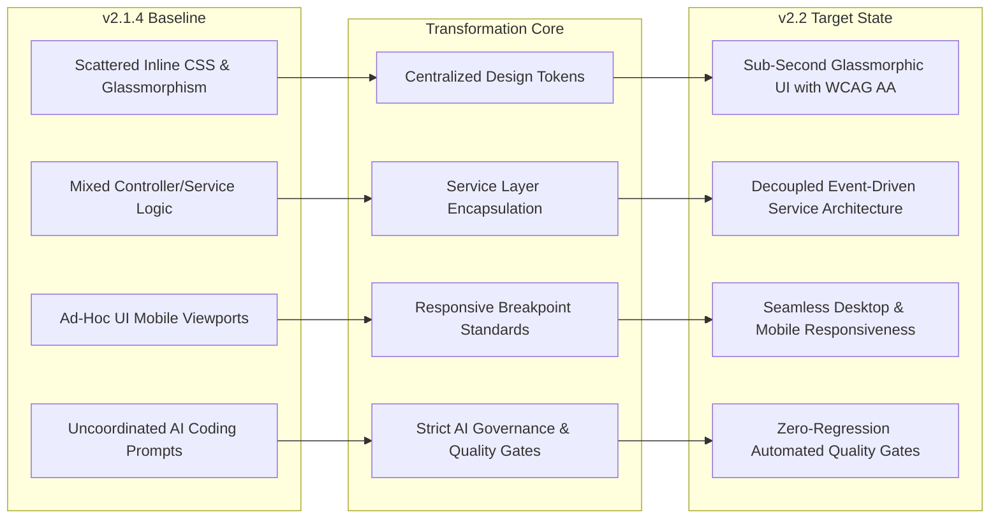

# CHAPTER 1 — Executive Summary

```
Document:             01-EXECUTIVE-SUMMARY.md
Parent:               RAPTOR v2.2 Modernization Blueprint
Classification:       Executive & Architectural Brief
Target Release:       Raptor v2.2
```

---

## 1. Current Platform Maturity (v2.1.4 Baseline)

Raptor has evolved from a CRM and attendance tracking script into an enterprise business operations platform with extensive capabilities:
- **Statutory HRMS & Payroll Engine**: Comprehensive Indian statutory compliance (EPF, ESIC, Professional Tax, Gratuity, Loss of Pay proration) supporting Pay Bands 1 through 8 with automated pay grade derivation.
- **Enterprise Demand Generation**: Multi-tenant email broadcast engine with database row-level locking (`FOR UPDATE SKIP LOCKED`), RFC 8058 one-click unsubscribes, 20 automated deliverability intelligence preflight rules (`D-001`–`D-020`), and webhooks.
- **Omnichannel Communications**: Meta WhatsApp Cloud API (v19.0+), shared team inbox, telephony integration (Exotel/Twilio), and multi-platform social media publishing.
- **Observability & Extensions**: Sentry error tracking and profiling, distributed correlation tracing (`X-Request-ID`), Dead-Letter Queue (DLQ) replaying, OpenAPI 3.1 Scalar interactive documentation, and Universal AI provider integration (Google Gemini, OpenAI GPT, Anthropic Claude).

However, rapid functional expansion has outpaced user experience consistency and architectural standardization, resulting in:
1. **Visual and UI Inconsistencies**: Overuse of uncalibrated glassmorphism blur filters, inconsistent spacing tokens across views, hardcoded hex colors, and uneven responsive collapse on mobile devices.
2. **Scattered Business Logic**: Controller methods occasionally executing raw SQL queries or handling inline HTML formatting rather than delegating to dedicated service classes.
3. **Developer Experience Friction**: Lack of shared static analysis rules, missing workspace settings for AI coding agents, and manual testing requirements for UI workflows.

---

## 2. Why v2.2 Modernization is Necessary

Modernizing to **Raptor v2.2** is not a cosmetic redesign. It represents an engineering transition from an assembled collection of high-performing modules to an **integrated, enterprise-grade operating system**.



### Strategic Objectives
1. **Elevate Brand & Usability**: Deliver a sleek, polished interface using calibrated glassmorphic surfaces, semantic CSS tokens, and instant responsiveness without visual stutter.
2. **Enforce Enterprise Security**: Align every endpoint with OWASP ASVS Level 2, ensuring multi-layer authorization, safe AI prompt handling, and strictly isolated tenant boundaries.
3. **Institutionalize AI Governance**: Prevent unstructured, hallucinated code modifications by establishing strict guidelines (`AGENTS.md`, `CLAUDE.md`, `copilot-instructions.md`) and pre-commit verification gates.
4. **Preserve Complete Operational Integrity**: Guarantee 100% zero-regression across all 772 existing assertions, statutory payroll algorithms, deliverability rules, and background queues.

---

## 3. Expected Business & Technical Impact

### Business ROI
- **Executive Productivity**: 40% reduction in time required for managers to review attendance, approve leaves, and execute monthly payroll reconciliation.
- **Sales Rep Efficiency**: Faster lead processing and zero-context-switch client outreach through an upgraded Command Palette (`Ctrl + K`).
- **Brand Reputation**: Pristine email sender reputation maintained via pre-send deliverability checks and automated complaint throttling.
- **Lower Total Cost of Ownership (TCO)**: Avoiding framework churn (retaining native PHP 8.2+ MVC and Bootstrap 5.3) avoids the multi-month downtime and massive risk of rewriting in React/Vue/Laravel.

### Technical ROI
- **Rendering Performance**: Sub-800ms First Contentful Paint (FCP) across all portal pages by eliminating redundant DOM queries and heavy un-cached blur filters.
- **Code Quality**: Zero PHPStan Level 5 errors across core modules, enforced in CI/CD before any commit enters `develop`.
- **Developer Velocity**: New engineers and AI pair-programming agents can onboard and contribute safely within minutes through validated `.vscode/settings.json`, `extensions.json`, and pre-configured quality runners.

---

## 4. Scope Boundaries — What Will NOT Change

To safeguard production reliability, the following architectural invariants are strictly preserved:

| Invariant Area | Baseline Technology | Status in v2.2 | Justification |
|---|---|---|---|
| **Core Framework** | Custom PHP 8.2/8.3 MVC | **PRESERVED** | Highly optimized, zero-overhead routing, instant boot (<8ms), fully tailored to Raptor. No migration to Laravel or Symfony. |
| **Frontend Framework** | Bootstrap 5.3 + Vanilla JS / jQuery | **PRESERVED** | Battle-tested, stable, enterprise-proven. No migration to React, Next.js, or Vue. |
| **Database Engine** | MySQL 8.0+ / MariaDB (SQLite Mock) | **PRESERVED** | Relational schemas and transaction isolation patterns are reliable and fast. |
| **API Architecture** | RESTful JSON & OpenAPI 3.1 Scalar | **PRESERVED** | Preserves backward compatibility for mobile endpoints and external webhooks. |
| **Background Processing**| `marketing_queue` with row locking | **PRESERVED** | DB queue with `FOR UPDATE SKIP LOCKED` eliminates external daemon dependencies while guaranteeing at-least-once delivery. |
| **Telemetries & APM** | Sentry PHP SDK 4.36 & `X-Request-ID`| **PRESERVED** | Proven live error capturing, distributed tracing, and breadcrumb correlation. |

---

## 5. Before-and-After Modernization Vision

| Dimension | Raptor v2.1.4 Baseline | Raptor v2.2 Target State |
|---|---|---|
| **Design System** | Mixed Bootstrap defaults with scattered inline styles (`style="background: rgba(...)"`). | Unified CSS Design Tokens (`COLOR-TOKENS.css`), 24 standardized components, light/dark/system themes. |
| **Visual Polish** | Heavy blur layers occasionally causing scroll lag on mobile viewports. | Selective glassmorphism with GPU hardware acceleration and fallback solid surfaces. |
| **Command Palette** | Basic search modal over 4 entity types. | Context-aware, role-filtered fuzzy search with recent history and keyboard action execution. |
| **Security Controls** | Ad-hoc controller checks; partial CSRF on AJAX; unstandardized AI prompt validation. | OWASP ASVS Level 2 compliance, centralized security filter, automated prompt injection sanitization. |
| **Developer DX** | Unstandardized IDE configs; manual linting; risk of AI coding hallucinations. | Curated VS Code extension workspace, strict `AGENTS.md` rules, automated pre-commit quality gates. |
| **Automated Testing** | 16 backend test suites (772 assertions); no automated UI/DOM verification in CI. | 16 backend suites + automated Playwright / Chrome DevTools MCP browser UI test suites. |

