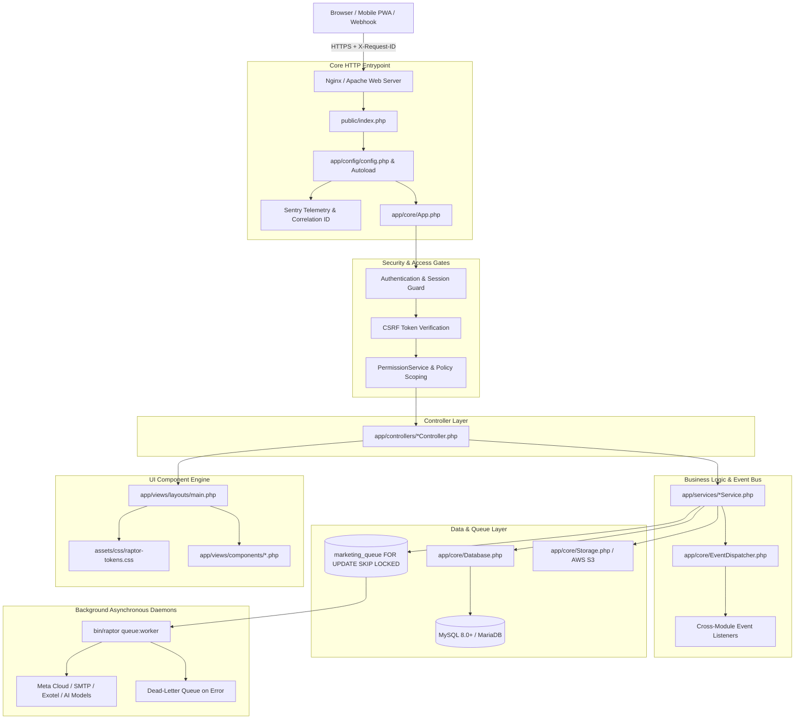
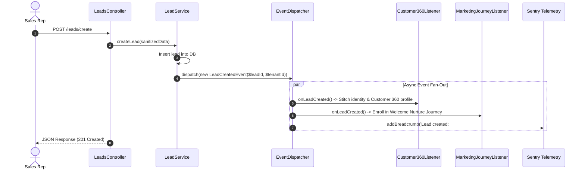

# CHAPTER 3 — Raptor v2.2 Target Architecture

```
Document:             03-TARGET-ARCHITECTURE.md
Parent:               RAPTOR v2.2 Modernization Blueprint
Classification:       System Architecture Specification
Target Release:       Raptor v2.2
```

---

## 1. Architectural Philosophy & Strategy

Raptor v2.2 does **not** introduce a monolithic framework rewrite. Instead, it transitions Raptor from a conventional procedural MVC model to an **Enterprise MVC+ (Service-Repository-Event) Architecture**:

1. **Thin Controllers**: Controllers are strictly responsible for HTTP request validation, parameter binding, permission enforcement, and returning standard view/JSON responses.
2. **Encapsulated Service Layer**: All business calculations (payroll tax computations, deliverability rules, geofence validations, AI prompts) live inside dedicated, testable service classes in `app/services/`.
3. **Decoupled Event Bus**: Cross-module communications (e.g. Lead Ingestion ➔ Customer 360 ➔ Audience Sync ➔ Email Preflight) execute through `EventDispatcher` using typed events, eliminating tight coupling between modules.
4. **Centralized Semantic Design System**: Views reference semantic CSS custom properties (`--raptor-*`) and standardized component partials (`app/views/components/`), eliminating ad-hoc inline styling.
5. **Observability by Design**: Every transaction carries an immutable `X-Request-ID`, propagating across controllers, database transactions, background queues, and Sentry breadcrumbs.

---

## 2. High-Level Target System Topology



---

## 3. Subsystem Architectural Boundaries

### 3.1 Controller Layer Specification
Controllers in v2.2 must strictly conform to the following contract:
- **No Direct PDO Queries**: Controllers must not invoke `$db->prepare()` or `$db->query()`. All data queries must pass through models or service repositories.
- **Uniform Response Envelopes**:
  - HTML views: `$this->viewWithLayout('view_name', 'main', $data)`
  - JSON API/AJAX: `$this->jsonOk($data, $message)` or `$this->jsonError($message, $code, $errors)`
- **Mandatory Authorization Gate**: Every controller constructor or action must call:
  ```php
  $this->requireAuth();
  $this->requirePermission('module_name', 'action_name');
  ```
- **Correlation Propagation**: The `$this->initCorrelationId()` helper must automatically inject `X-Request-ID` into response headers and Sentry scopes.

---

### 3.2 Service Layer & Domain Isolation
The business logic is partitioned into six clear service clusters:

```mermaid
classDiagram
    class AiService {
        +testConnection(provider, key, model)
        +generate(prompt, options)
        +generateSubjectLines(goal, audience)
        +generateSmartReply(message, context)
    }

    class PayrollService {
        +calculatePayrollRun(month, year)
        +calculateEmployeeSalary(userId, attendanceDays, lops)
        +verifyPrePayrollChecklist(month, year)
        +generatePayslipPdf(payrollId)
    }

    class DeliverabilityService {
        +runPreflightCheck(campaignId)
        +verifyDomainDns(domainId)
        +processBounceWebhook(payload)
        +processUnsubscribe(contactId, campaignId)
    }

    class OmnichannelService {
        +sendWhatsAppMessage(to, template, params)
        +dispatchEmailBroadcast(broadcastId)
        +initiateTelephonyBridge(agentId, leadId)
        +publishSocialPost(platforms, content)
    }

    class AttendanceService {
        +clockIn(userId, coordinates, selfiePath)
        +clockOut(userId)
        +verifyGeofence(lat, lng)
        +reconcileDailyAttendance(date)
    }

    class Customer360Service {
        +stitchIdentity(visitorId, email, phone)
        +recalculateLeadScore(customerId)
        +syncAudienceSegments()
    }
```



---

### 3.3 Event-Driven Interactions (`EventDispatcher`)

To prevent direct coupling across unrelated modules, Raptor v2.2 enforces the PSR-14 event pipeline. Example cross-module lifecycle:



---

### 3.4 Database Query Profiling & Performance Guard
In v2.2, `app/core/Database.php` incorporates an automatic execution timer:

```php
// Target Pattern for app/core/Database.php
public function executeTimed(PDOStatement $stmt, array $params = [], float $slowThresholdMs = 200.0): bool {
    $start = microtime(true);
    $result = $stmt->execute($params);
    $durationMs = (microtime(true) - $start) * 1000.0;

    if ($durationMs > $slowThresholdMs) {
        if (class_exists('\Sentry\SentrySdk')) {
            \Sentry\addBreadcrumb(new \Sentry\Breadcrumb(
                \Sentry\Breadcrumb::LEVEL_WARNING,
                \Sentry\Breadcrumb::TYPE_DEFAULT,
                'db.slow_query',
                sprintf('Query took %.2fms: %s', $durationMs, substr($stmt->queryString, 0, 200)),
                ['duration_ms' => $durationMs, 'params' => array_keys($params)]
            ));
        }
    }
    return $result;
}
```

---

### 3.5 Target Frontend Architecture & Design System Integration

```
public/
├── index.php                      # Single entrypoint
├── update.php                     # Controlled deployment runner
├── manifest.json                  # PWA specification
└── assets/
    ├── css/
    │   ├── raptor-tokens.css      # CSS custom properties (color, spacing, typography)
    │   ├── raptor-glass.css       # Hardware-accelerated glassmorphism surfaces
    │   └── raptor-components.css # Standardized component overrides
    └── js/
        ├── raptor-core.js         # CSRF helper, toast engine, modal manager
        ├── raptor-command.js      # Ctrl+K palette search & keyboard handler
        └── raptor-theme.js        # Theme persistence & early DOM head initialier
```

Views load component templates from `app/views/components/`:
- `card.php`
- `table.php`
- `modal.php`
- `status_badge.php`
- `stat_metric.php`
- `empty_state.php`

This ensures that UI updates are applied centrally across all 50 modules without altering individual controller templates.
