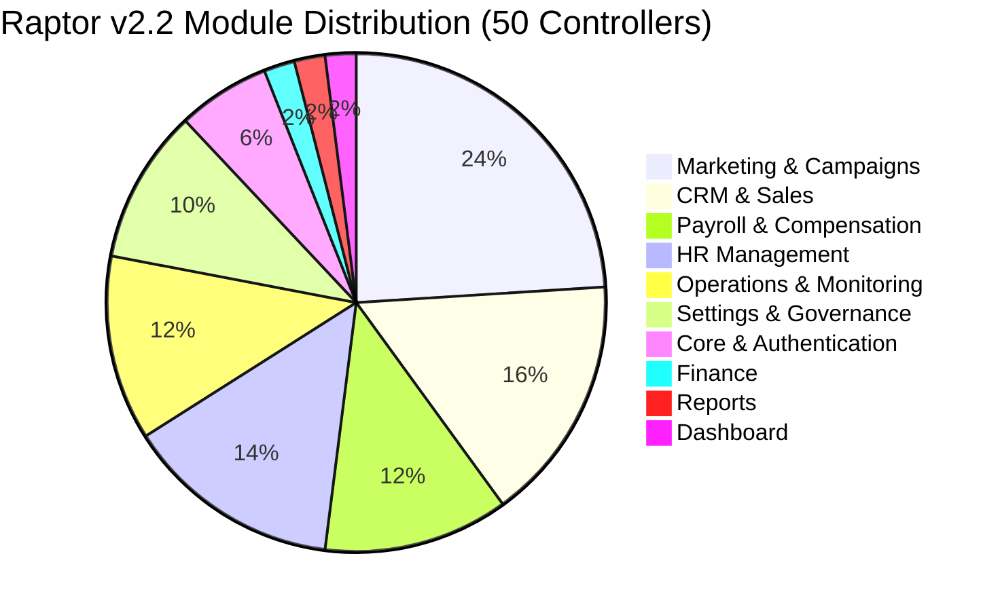

# Discovered Module Inventory & Modernization Classification

```
Document:             MODULE-INVENTORY.md
Directory:            RAPTOR-V2.2-BLUEPRINT/MODULE-MODERNIZATION/
Classification:       Complete Codebase Inventory & Priority Tiers
Target Release:       Raptor v2.2
Verified Modules:     50 Controllers, 59 Models, 22 Services
```

---

## 1. Inventory Summary by 10 Functional Modules

The codebase audit verified 50 controllers, 59 models, and 22 services organized across the 10 core enterprise modules:



---

## 2. Exhaustive Discovered Components Catalog

### 1. Dashboard Module
- **Controllers (1)**: `DashboardController.php`
- **Models (2)**: `CustomDashboard.php`, `DashboardModule.php`
- **Services (0)**: Uses direct controller aggregation
- **Priority Tier**: **P1 (Core Usability)**

### 2. My Day (Employee Self-Service)
- **Controllers (3)**: Interacts with `AttendanceController.php`, `LeavesController.php`, `FollowupsController.php`
- **Models (3)**: `Attendance.php`, `Leave.php`, `FollowUp.php`
- **Services (1)**: `PayslipPdfService.php`
- **Priority Tier**: **P2 (Employee Usability)**

### 3. CRM & Sales
- **Controllers (8)**: `LeadsController.php`, `CustomersController.php`, `AccountSalesController.php`, `InboxController.php`, `CommunicationsController.php`, `MeetingsController.php`, `TargetsController.php`, `ContactsController.php`
- **Models (10)**: `Lead.php`, `Customer.php`, `AccountOpportunity.php`, `AccountSalesActivity.php`, `InboxThread.php`, `InboxMessage.php`, `Communication.php`, `Meeting.php`, `Target.php`, `Contact.php`
- **Services (3)**: `BulkImportService.php`, `ContactImportService.php`, `TelephonyService.php`
- **Priority Tier**: **P1 (Core Business Operations)**

### 4. Marketing & Demand Generation
- **Controllers (12)**: `CampaignsController.php`, `EmailCampaignsController.php`, `CampaignTrackingController.php`, `CampaignWebhooksController.php`, `FormsController.php`, `ApiLeadCaptureController.php`, `JourneysController.php`, `SocialController.php`, `SocialPublisherController.php`, `WebsiteAnalyticsController.php`, `WhatsAppController.php`, `WhatsAppWebhookController.php`
- **Models (14)**: `Campaign.php`, `CampaignBroadcast.php`, `CampaignTemplate.php`, `CampaignList.php`, `CampaignSegment.php`, `CampaignSuppression.php`, `CampaignDomain.php`, `MarketingForm.php`, `MarketingJourney.php`, `SocialAccount.php`, `ContentPost.php`, `WebsiteAnalytics.php`, `WhatsAppConversation.php`, `WhatsAppMessage.php`
- **Services (11)**: `EmailQueueService.php`, `PreflightEngine.php`, `PreSendChecklistService.php`, `ConsentService.php`, `DeliverabilityHealthReportService.php`, `DomainVerificationService.php`, `TrackingService.php`, `UnsubscribeService.php`, `WarmupScheduleService.php`, `WebhookProcessorService.php`, `WhatsAppService.php`
- **Priority Tier**: **P0 (Critical Reliability & Anti-Spam)**

### 5. HR Management (Pure HR)
- **Controllers (5)**: `HrmsController.php`, `UsersController.php`, `TeamsController.php`, `LeavesController.php`, `EditrequestsController.php`
- **Models (6)**: `Hrms.php`, `User.php`, `Team.php`, `Leave.php`, `DataEditRequest.php`, `Role.php`
- **Services (0)**: Legacy controller queries (Target of extraction)
- **Priority Tier**: **P1 (People Governance)**

### 6. Payroll & Compensation (Pure Statutory Payroll)
- **Controllers (2)**: `PayrollController.php`, `FileController.php`
- **Models (2)**: `Payroll.php`, `Employee.php` (in DB)
- **Services (2)**: `PayslipPdfService.php`, `PayslipHelper.php`
- **Priority Tier**: **P0 (Critical Statutory Compliance)**

### 7. Operations & Field Logistics
- **Controllers (6)**: `AttendanceController.php`, `TasksController.php`, `CalendarController.php`, `ClientsController.php`, `PerformanceController.php`, `LocationController.php`
- **Models (6)**: `Attendance.php`, `Task.php`, `Client.php`, `Performance.php`, `LocationLog.php`, `Monitoring.php`
- **Services (1)**: `AlertService.php`
- **Priority Tier**: **P2 (Operational Polish)**

### 8. Finance
- **Controllers (1)**: `InvoicesController.php`
- **Models (1)**: `Invoice.php`
- **Services (0)**: PDO queries in model
- **Priority Tier**: **P2 (Business Operations)**

### 9. Reports & Historical Analytics
- **Controllers (1)**: `ReportsController.php`
- **Models (2)**: `ReportSuite.php`, `AnalyticsEntry.php`
- **Services (1)**: `CampaignAnalyticsService.php`
- **Priority Tier**: **P2 (Business Polish)**

### 10. System Settings & Developer Hub
- **Controllers (5)**: `SettingsController.php`, `RolesController.php`, `QuickSearchController.php`, `NotificationsController.php`, `ApidocsController.php`
- **Models (3)**: `AlertRule.php`, `Notification.php`, `Role.php`
- **Services (2)**: `AiService.php`, `EmailService.php`
- **Priority Tier**: **P0 (Critical Security & Governance)**

---

## 3. Prioritized Modernization Roadmap Tiers

- **Tier P0: Critical Security & High-Risk Reliability**
  - Settings & Quick Search (Subtree authorization leak fix).
  - Statutory Payroll (Calculation immutability & payslip caching).
  - Email Marketing (Queue concurrency & deliverability engine).
- **Tier P1: Core Usability & Design System Standardization**
  - Global CSS Tokens & Selective Glassmorphism adoption.
  - Command Palette (`Ctrl + K`) redesign with keyboard navigation.
  - CRM & Sales views (Leads, Customer 360, Deals Pipeline).
  - HR Management views (Employee directory, team hierarchy, leave calendars).
- **Tier P2: Major Business Workflows & Mobile Optimization**
  - Attendance mobile check-in & geofence UI.
  - Omnichannel inbox real-time thread refresh.
  - Invoicing & Finance UI standardization.
  - Reports Center export performance.
- **Tier P3: Optimization & Polish**
  - DataTables column visibility state persistence.
  - Skeleton loading shimmer across secondary screens.
  - Micro-interactions, tooltips, and toast sound settings.

