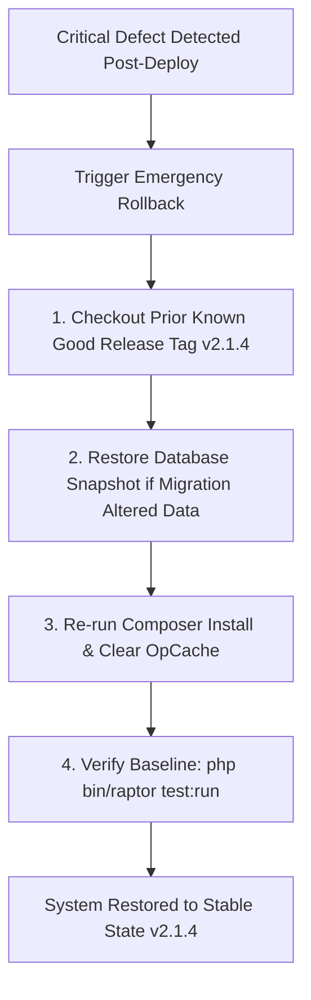

# Raptor v2.2 Release Acceptance Checklist & Rollback Runbook

```
Document:             RELEASE-ACCEPTANCE.md
Directory:            RAPTOR-V2.2-BLUEPRINT/ROADMAP/
Classification:       Release Governance & Deployment Runbook
Target Release:       Raptor v2.2
```

---

## 1. Release Acceptance Criteria Checklist

Before the release tag `v2.2.0` can be deployed to production, the Release Manager, QA Lead, Security Architect, and CTO must sign off on the following 10 mandatory conditions:

| # | Acceptance Criterion | Required Target | Verification Method | Status |
|---|---|---|---|---|
| **1** | **Zero Regression Invariant** | 100% Pass Rate: **772 / 772 baseline assertions pass** | `php bin/run_all_campaign_tests.php` | [ ] Pending |
| **2** | **New Module Test Coverage** | 100% of new components covered with tests | `php bin/raptor test:run` | [ ] Pending |
| **3** | **Static Analysis Gate** | 0 errors at PHPStan Level 5 | `phpstan analyse -c phpstan.neon` | [ ] Pending |
| **4** | **Security & OWASP ASVS** | 0 Critical or High vulnerabilities; 0 vulnerable packages | `bin/raptor test:security`, `composer audit` | [ ] Pending |
| **5** | **Tenant & Subtree Isolation** | Zero cross-rep or cross-team data leaks in search or detail views | Automated security test suite 2 | [ ] Pending |
| **6** | **Statutory Payroll Parity** | Exact penny-level parity with historical payroll calculations | `bin/test_payroll_pipeline.php` | [ ] Pending |
| **7** | **Visual & Accessibility** | 0 WCAG 2.2 Level AA violations; verified light/dark contrast | Chrome DevTools MCP audit | [ ] Pending |
| **8** | **E2E Browser Journeys** | 10 critical user journeys succeed on desktop and mobile viewports | Playwright E2E suite (`npm test`) | [ ] Pending |
| **9** | **Live Telemetry & Sentry** | Sentry SDK active; `X-Request-ID` attached to all transactions | `bin/raptor sentry:test` | [ ] Pending |
| **10**| **Rollback Runbook Validated** | Verified database migration rollback and clean Git tag checkout | Staging server dry run | [ ] Pending |

---

## 2. Production Deployment Sequence (Zero-Downtime)

1. **Pre-Deployment Backup**:
   - Take snapshot of production database (`raptor_crm_db`).
   - Backup `storage/` directory and current `.env` configuration.
2. **Git Tag Tagging**:
   - Tag release commit on `main`:
     ```bash
     git tag -a v2.2.0 -m "Release v2.2.0: Enterprise UI/UX, Security Hardening & Developer DX"
     git push origin main --tags
     ```
3. **Execute Production Sync**:
   - Trigger the secure deployment runner:
     ```text
     https://<production-domain>/update.php?key=raptor_deploy_2026
     ```
   - Runner pulls tag `v2.2.0`, runs `composer install --no-dev --optimize-autoloader`, and applies any new migrations.
4. **Post-Deployment Smoke Verification**:
   - Hit `index.php?route=home/test_sentry` to verify Sentry event dispatch.
   - Run CLI diagnostic: `php bin/raptor health:check`.
   - Perform test login and sample lead lookup.

---

## 3. Emergency Rollback Runbook

If any critical defect or unexpected behavioral regression is detected post-deployment:



### Rollback Commands:
```bash
# On production server
cd /var/www/html/raptor
git fetch --tags
git checkout v2.1.4
php composer.phar install --no-dev --optimize-autoloader

# If a schema rollback is required:
php bin/raptor migrate:rollback

# Verify system health
php bin/raptor health:check
```
