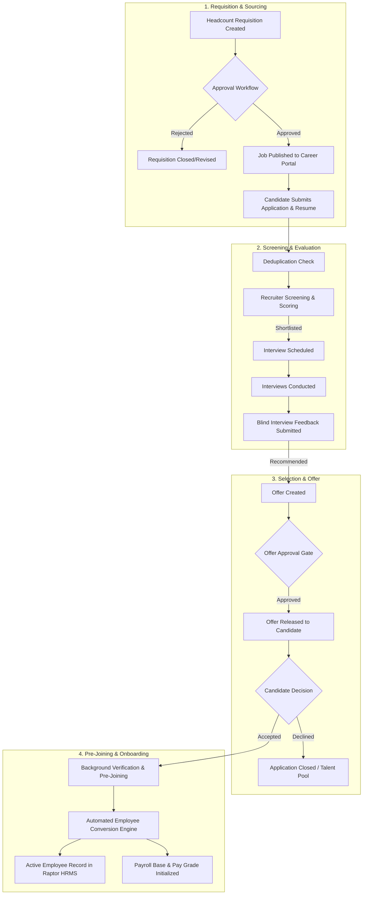

# Raptor v2.3 — Enterprise Recruitment Management Module (ATS)
## 01. Executive Summary & Strategic Scope

```
Document:             01-EXECUTIVE-SUMMARY.md
Directory:            RAPTOR-V2.3-RECRUITMENT-BLUEPRINT/
Classification:       Product Vision, Business Objectives & Strategic Scope
Target Release:       Raptor v2.3
```

---

## 1. Executive Summary & Product Vision

In modern enterprises, recruitment activities often suffer from severe operational fragmentation: hiring managers email unstructured vacancy requirements to HR, resumes are scattered across disconnected inboxes and local hard drives, interview feedback is collected informally via messaging apps, candidate offer negotiations are unversioned, and when a candidate is finally hired, HR clerks manually re-enter the same personal and tax data into the core HRMS database.

This fragmentation creates substantial organizational liabilities:
- **Prolonged Time-to-Fill**: Average hiring cycles drag out due to coordination bottlenecks and missing interview feedback.
- **Data Leakage & Compliance Exposure**: Unsecured candidate resumes containing sensitive Personally Identifiable Information (PII) sit in unmonitored mailboxes and download folders, violating the Digital Personal Data Protection Act (DPDP 2023) and GDPR.
- **Duplicate Records & Data Errors**: Manual re-entry of selected candidates into the employee database frequently introduces duplicate profiles, misspelled names, incorrect tax IDs, or misaligned pay grades.
- **Recruiter Blindspots**: Executive leadership lacks real-time visibility into hiring pipelines, recruiter workloads, and requisition aging.

### The Raptor v2.3 Solution
Raptor v2.3 introduces the **Enterprise Recruitment Management Module (ATS)**—a fully integrated, secure, and modern Applicant Tracking System embedded natively within the Raptor platform. It unifies the entire talent acquisition lifecycle from organizational headcount demand planning through job requisition approvals, public career portal sourcing, structured multi-round interviewing, offer approvals, and zero-defect automated employee conversion into the existing Raptor HRMS.

---

## 2. Strategic Objectives & Success KPIs

| Metric | Industry Problem | Raptor v2.3 Target Objective | Measurement Method |
|---|---|---|---|
| **Time to Fill** | Bottlenecks in requisition approval and interview feedback cause vacancies to stay open for 60+ days. | Establish automated approval workflows and feedback reminders to compress cycle times. | Requisition Approval Date to Offer Acceptance Date. |
| **Time to Hire** | Candidates drop out due to sluggish multi-week recruiter response times. | Streamline candidate stage transitions and automate stage acknowledgement triggers. | Candidate Application Date to Offer Acceptance Date. |
| **Offer Acceptance Rate** | Out-of-band salary negotiations and unapproved offer letters create candidate drop-offs. | Standardize compensation component approval matrix and versioned offer letters. | Total Accepted Offers / Total Issued Offers. |
| **Data Integrity in Onboarding** | Manual re-entry of candidate details into HRMS causes 15-20% error rates. | 100% automated, transaction-safe conversion of accepted candidates into employees with zero duplicates. | Database verification: 0 manual re-entry errors. |
| **Regulatory Compliance** | Uncontrolled resume distribution exposes enterprise to DPDP & privacy penalties. | 100% private, authenticated document storage (`STORAGE_PATH`), consent logging, and retention enforcement. | Security audit: 0 unauthenticated file accesses. |

---

## 3. Scope Boundary Definition

### 3.1 P0 (Essential Core Capabilities — Phase 1 to Phase 6)
- **Recruitment Dashboard & Pipeline KPI Center** (`REC-001`).
- **Job Requisition Management & Vacancy Tracking** (`REC-003`).
- **Configurable Multi-Level Requisition Approval Workflow** (`REC-004`).
- **Reusable Job Description Template Library** (`REC-005`).
- **Candidate Master Database & Master Deduplication Engine** (`REC-007`).
- **Public Career Portal & Application Intake Wizard** (`REC-008`).
- **Encrypted & Private Resume/Document Management** (`REC-009`).
- **Applicant Tracking System (ATS) Pipeline & Stage Transitions** (`REC-010`).
- **Structured Candidate Screening & Scorecards** (`REC-011`).
- **Multi-Round Interview Scheduling & Conflict Detection** (`REC-012`).
- **Blind/Independent Interview Feedback & Scoring** (`REC-013`).
- **Offer Generation, Approval Workflow & Salary Masking** (`REC-016`).
- **Transaction-Safe Employee Conversion** (`REC-019`).
- **Recruitment Operational & Metric Reporting** (`REC-020`).
- **Granular RBAC, Audit Logging & Security Invariants** (`REC-023`).

### 3.2 P1 (Advanced Capabilities — Phase 7 to Phase 9)
- **Manpower Planning & Headcount Demand Tracking** (`REC-002`).
- **Assessment Management & Assignment Evaluation** (`REC-014`).
- **Automated Candidate Communications (Email/WhatsApp via Queue)** (`REC-015`).
- **Background Verification (BGV) Tracking** (`REC-017`).
- **Pre-Joining Checklist & Document Collection Gate** (`REC-018`).
- **AI-Assisted Recruitment via Multi-Provider AiService** (`REC-022`):
  - Resume summarization and skill extraction.
  - Candidate-job evidence matching.
  - Role-specific interview question suggestions.
  - Job description drafting and refinement.

### 3.3 Deferred / Future Enhancements (Post v2.3 Release)
- Third-party job board API aggregators (LinkedIn Recruiter sync, Indeed XML feeds).
- External recruitment agency portal with vendor billing.
- Employee referral portal with automated reward payout.
- Real-time video interview proctoring and automated speech analysis.

---

## 4. End-to-End Enterprise Recruitment Lifecycle



---

## 5. Architectural Alignment with Raptor Platform

1. **Seamless HRMS Interoperability**:
   The module operates within the existing database schema and shares master entities:
   - `users` (hiring managers, interviewers, recruiters, approvers).
   - `employees` (reporting managers, departmental heads, converted employees).
   - `departments`, `teams`, `branches` (organizational structure and geofences).
   - `roles` and `permissions` (RBAC access gates).
2. **Standardized Glassmorphic UI**:
   Adheres to Raptor v2.2 Design System tokens (`raptor-tokens.css`, `raptor-glass.css`), supporting dark/light mode switching, responsive mobile layouts, and standard UI components (`card`, `stat_tile`, `badge`, `empty_state`).
3. **Enterprise Defense-in-Depth**:
   Strict enforcement of `PermissionService::can()`, `Policy::getTeamSubtreeUserIds()`, CSRF tokens on all state-altering endpoints, sanitized input, prepared SQL statements, and MIME validation for file uploads.
