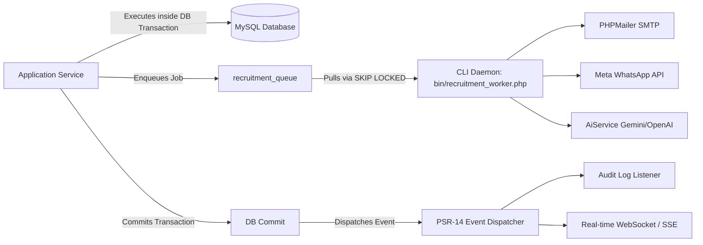

# Raptor v2.3 — Enterprise Recruitment Management Module (ATS)
## API 02. PSR-14 Domain Events & Asynchronous Queue Engine

```
Document:             API/EVENT-AND-QUEUE-SPECIFICATION.md
Directory:            RAPTOR-V2.3-RECRUITMENT-BLUEPRINT/API/
Classification:       Event-Driven Integration, Background Workers & Queue Architecture
Target Release:       Raptor v2.3
Standards:            PSR-14 Event Dispatcher & Transactional Queue Pattern
```

---

## 1. Domain Event Architecture

Raptor v2.3 leverages the PSR-14 Event Dispatcher to decouple business transactions from side-effects (notifications, audit logging, analytics indexing, external integrations).



---

## 2. Domain Event Catalog

| Event Class Name | Triggering Action | Payload Metadata | Registered Listeners |
|---|---|---|---|
| `RecruitmentRequisitionCreated` | Manager submits headcount request | `requisition_id`, `hiring_manager_id`, `department` | Notify department head approver. |
| `RecruitmentRequisitionApproved` | Requisition approval step completed | `requisition_id`, `approver_id`, `is_final` | Notify recruiter; enable job publishing. |
| `RecruitmentJobPublished` | Job vacancy listed on career portal | `job_id`, `job_slug`, `department` | Update public search index & sitemap. |
| `RecruitmentApplicationSubmitted` | Candidate applies for vacancy | `application_id`, `candidate_id`, `job_id` | Enqueue acknowledgement email; notify recruiter. |
| `RecruitmentApplicationStageChanged` | Application moved on Kanban | `application_id`, `from_stage`, `to_stage`, `actor_id` | Record stage history; update pipeline metrics. |
| `RecruitmentInterviewScheduled` | Interview slot and panel confirmed | `interview_id`, `application_id`, `panel_ids` | Enqueue calendar invites (iCal/Email/WhatsApp). |
| `RecruitmentInterviewFeedbackSubmitted` | Panel member submits scorecard | `interview_id`, `interviewer_id`, `score` | Check if all panel feedback received; notify recruiter. |
| `RecruitmentOfferReleased` | Approved offer sent to candidate | `offer_id`, `candidate_id`, `expiry_date` | Enqueue secure offer delivery notification. |
| `RecruitmentOfferAccepted` | Candidate accepts formal offer | `offer_id`, `application_id`, `joining_date` | Notify hiring manager & onboarding coordinator; trigger BGV. |
| `RecruitmentOfferDeclined` | Candidate rejects formal offer | `offer_id`, `decline_reason` | Notify recruiter; reopen candidate pipeline. |
| `RecruitmentEmployeeConversionCompleted` | Candidate converted to employee | `application_id`, `employee_id`, `user_id` | Initialize HRMS profile, leave balance & payroll grade. |

---

## 3. Transactional Queue Specification (`recruitment_queue`)

External communications and AI processing must **never** execute synchronously inside web HTTP requests or open database transactions.

### 3.1 Worker Execution Loop (`bin/recruitment_worker.php`)
```php
declare(strict_types=1);

require_once __DIR__ . '/../app/bootstrap.php';

class RecruitmentQueueWorker {
    private const BATCH_SIZE = 10;
    private const MAX_ATTEMPTS = 3;

    public function work(): void {
        $db = Database::getInstance()->getConnection();
        $workerId = gethostname() . ':' . getmypid();

        while (true) {
            $db->beginTransaction();
            try {
                // MySQL 8.0+ SKIP LOCKED row reservation
                $stmt = $db->prepare("
                    SELECT queue_id, job_type, payload_json, attempts 
                    FROM recruitment_queue
                    WHERE status = 'pending' AND scheduled_at <= NOW()
                    ORDER BY queue_id ASC
                    LIMIT " . self::BATCH_SIZE . "
                    FOR UPDATE SKIP LOCKED
                ");
                $stmt->execute();
                $jobs = $stmt->fetchAll(PDO::FETCH_ASSOC);

                if (empty($jobs)) {
                    $db->commit();
                    sleep(2);
                    continue;
                }

                // Lock selected jobs
                $jobIds = array_column($jobs, 'queue_id');
                $inClause = implode(',', array_map('intval', $jobIds));
                $db->exec("UPDATE recruitment_queue SET status = 'processing', locked_at = NOW(), locked_by = '{$workerId}' WHERE queue_id IN ({$inClause})");
                $db->commit();

                // Process jobs sequentially outside transaction
                foreach ($jobs as $job) {
                    $this->processJob($job);
                }
            } catch (\Throwable $e) {
                if ($db->inTransaction()) {
                    $db->rollBack();
                }
                error_log("Recruitment Queue Worker Error: " . $e->getMessage());
                sleep(5);
            }
        }
    }
}
```

### 3.2 Exponential Backoff & Dead-Letter Queue (DLQ)
When a queue job fails (e.g. SMTP connection timeout, Meta WhatsApp API 500 error):
1. `attempts` is incremented.
2. If `attempts < max_attempts`, `scheduled_at` is recalculated with exponential backoff:
   $$\text{Delay} = 30 \times (2^{\text{attempts} - 1}) \text{ seconds}$$
   (Attempt 1 fail: 30s delay; Attempt 2 fail: 60s delay; Attempt 3 fail: 120s delay).
3. If `attempts >= max_attempts`, status is updated to `'dlq'` and an alert is recorded in Sentry and the admin alert dashboard.
