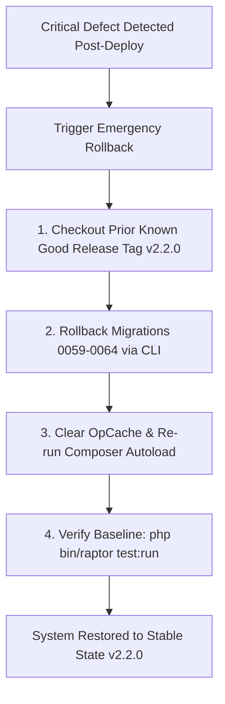

# Raptor v2.3 — Enterprise Recruitment Management Module (ATS)
## Roadmap 02. Release Acceptance Criteria & Emergency Rollback Runbook

```
Document:             ROADMAP/RELEASE-ACCEPTANCE.md
Directory:            RAPTOR-V2.3-RECRUITMENT-BLUEPRINT/ROADMAP/
Classification:       Release Governance, Acceptance Gates & Rollback Runbook
Target Release:       Raptor v2.3
```

---

## 1. Release Acceptance Criteria Checklist (10 Gates)

Before releasing `v2.3.0` to production, all 10 mandatory conditions must be verified and signed off:

| # | Acceptance Criterion | Target Requirement | Verification Method | Status |
|---|---|---|---|---|
| **1** | **Zero Regression Invariant** | 100% Pass Rate: All 878 baseline assertions continue passing without failure. | `php bin/run_all_campaign_tests.php` | [ ] Pending |
| **2** | **New Recruitment Test Coverage** | 100% of new recruitment services covered by automated unit/integration tests (>80 new assertions). | `php bin/raptor test:run recruitment` | [ ] Pending |
| **3** | **Static Analysis & Syntax** | 0 PHP syntax errors across all modified/new files. | `php -l <file>` across all new files | [ ] Pending |
| **4** | **Security & ASVS Compliance** | Zero IDOR vulnerabilities on candidate documents; strict MIME validation; CSRF enforced. | Security test suite & code audit | [ ] Pending |
| **5** | **Tenant & Subtree Isolation** | Zero cross-team or cross-tenant application leaks; interviewers only view assigned candidates. | Automated RBAC test pack | [ ] Pending |
| **6** | **Idempotent Employee Conversion** | 100% transaction safety: Zero duplicate employees created upon candidate conversion. | Integration test: `testEmployeeConversion` | [ ] Pending |
| **7** | **Blind Evaluation Integrity** | Interviewers cannot access peer evaluations via API or UI prior to submitting their own feedback. | Security test: `testBlindFeedbackGate` | [ ] Pending |
| **8** | **E2E Browser Automation** | Full hiring journey (Requisition → Job → Application → Interview → Offer → Hire) succeeds. | Playwright E2E suite (`bin/raptor test:ui`) | [ ] Pending |
| **9** | **AI Fallback & PII Redaction** | Recruitment functions fully when AI is offline; zero candidate PII sent in AI prompts. | Mock AI offline test | [ ] Pending |
| **10**| **Rollback Runbook Validated** | Verified database migration rollback and clean Git tag checkout. | Staging server dry run | [ ] Pending |

---

## 2. Production Deployment Sequence (Zero-Downtime)

1. **Pre-Deployment Backup**:
   - Snapshot production database (`raptor_crm_db`).
   - Backup `storage/` directory and `.env` configuration.
2. **Git Tag Deployment**:
   ```bash
   git tag -a v2.3.0 -m "Release v2.3.0: Enterprise Recruitment Management ATS Module"
   git push origin main --tags
   ```
3. **Execute Production Sync**:
   - Trigger secure deployment runner:
     `https://<production-domain>/update.php?key=raptor_deploy_2026`
   - Runner checks out `v2.3.0`, executes `composer install --no-dev --optimize-autoloader`, and applies sequential migrations `0059_...` through `0064_...`.
4. **Post-Deployment Verification**:
   - Run CLI diagnostic: `php bin/raptor health:check`.
   - Verify public career portal: `curl -I https://<production-domain>/public/index.php?route=careers`.
   - Submit sample application and verify acknowledgement email queue.

---

## 3. Emergency Rollback Runbook

If a critical defect or data anomaly is detected post-deployment:



### Rollback Commands:
```bash
# On production server
cd /var/www/html/raptor
git fetch --tags
git checkout v2.2.0
php composer.phar dump-autoload -o

# Rollback recruitment schema changes
php bin/raptor migrate:rollback --step=6

# Verify system health and baseline test suite
php bin/raptor health:check
php bin/run_all_campaign_tests.php
```
