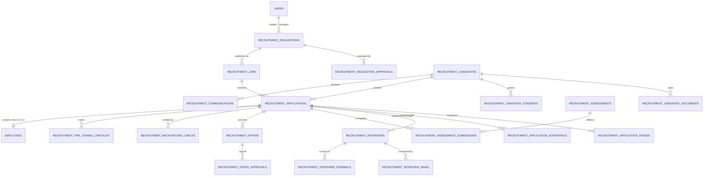

# Raptor v2.3 — Enterprise Recruitment Management Module (ATS)
## Schema 03. Entity-Relationship Dictionary & Cardinality

```
Document:             SCHEMA/ENTITY-RELATIONSHIP-DICTIONARY.md
Directory:            RAPTOR-V2.3-RECRUITMENT-BLUEPRINT/SCHEMA/
Classification:       Data Dictionary, Foreign Key Mapping & Cardinality Rules
Target Release:       Raptor v2.3
```

---

## 1. Entity-Relationship Diagram (ERD)



---

## 2. Entity Cardinality Rules

| Parent Entity | Child Entity | Cardinality | Cascade Action | Business Rule & Invariant |
|---|---|---|---|---|
| `recruitment_requisitions` | `recruitment_requisition_approvals` | 1 : N | `ON DELETE CASCADE` | Deleting a draft requisition removes pending approval requests. |
| `recruitment_requisitions` | `recruitment_jobs` | 1 : N | `ON DELETE RESTRICT` | An approved requisition can spawn one or more published job postings. Requisitions cannot be deleted if active jobs exist. |
| `recruitment_candidates` | `recruitment_applications` | 1 : N | `ON DELETE RESTRICT` | A candidate profile (person) can submit multiple applications over time across distinct jobs. |
| `recruitment_jobs` | `recruitment_applications` | 1 : N | `ON DELETE RESTRICT` | A job receives multiple candidate applications. A job with submitted applications cannot be deleted. |
| `recruitment_applications` | `recruitment_application_stages` | 1 : N | `ON DELETE CASCADE` | Every status update creates an immutable stage history record. |
| `recruitment_applications` | `recruitment_interviews` | 1 : N | `ON DELETE CASCADE` | An application can undergo multiple interview rounds (Technical, HR, Leadership). |
| `recruitment_interviews` | `recruitment_interview_panel` | 1 : N | `ON DELETE CASCADE` | An interview round can be conducted by multiple interviewers (panel). |
| `recruitment_interviews` | `recruitment_interview_feedback` | 1 : N | `ON DELETE CASCADE` | Each assigned interviewer submits an independent, blind evaluation scorecard. |
| `recruitment_applications` | `recruitment_offers` | 1 : N | `ON DELETE RESTRICT` | An application can have multiple revisions of an offer, but only one `released` or `accepted` offer at any given time. |
| `recruitment_applications` | `employees` | 1 : 1 (Optional) | `ON DELETE SET NULL` | When an application reaches `hired`, it links to exactly one newly created or existing `employee_id`. |

---

## 3. Data Dictionary: Key Field Constraints

### 3.1 `recruitment_requisitions`
- `requisition_code`: `VARCHAR(50)`, format `REQ-YYYY-XXXX` (e.g. `REQ-2026-0042`), unique system-generated identifier.
- `vacancies`: `INT NOT NULL DEFAULT 1`, checked `> 0`.
- `is_salary_confidential`: `TINYINT(1)`, default `1`. When true, salary is masked from interviewers and hiring managers lacking `recruitment.offer.view_salary`.
- `status`: Enum (`draft`, `pending_approval`, `changes_requested`, `approved`, `rejected`, `open`, `partially_filled`, `filled`, `on_hold`, `cancelled`, `closed`).

### 3.2 `recruitment_candidates`
- `candidate_code`: `VARCHAR(50)`, format `CAN-YYYY-XXXXX`, unique system-generated identifier.
- `email`: `VARCHAR(150)`, indexed, normalized to lower-case.
- `phone`: `VARCHAR(30)`, indexed, normalized to E.164 international format (`+919876543210`).
- `is_blacklisted`: `TINYINT(1)`, default `0`. Blocks future application submissions when active.

### 3.3 `recruitment_applications`
- `application_code`: `VARCHAR(50)`, format `APP-YYYY-XXXXX`, unique external candidate reference number.
- `current_stage`: Enum with 17 discrete stages from `applied` through `hired`, `rejected`, or `withdrawn`.
- `match_score_advisory`: `TINYINT NULL`, constrained `0` to `100`. Strictly advisory AI/rubric score; not usable for automated decisions.
- `converted_employee_id`: `INT NULL UNIQUE`, foreign key to `employees(employee_id)`. Enforces strict 1-to-1 conversion idempotency.

### 3.4 `recruitment_candidate_documents`
- `storage_key`: `VARCHAR(255)`, path inside `STORAGE_PATH` (e.g. `recruitment/2026/11/ab12cd...pdf`).
- `mime_type`: `VARCHAR(100)`, whitelisted: `application/pdf`, `application/msword`, `application/vnd.openxmlformats-officedocument.wordprocessingml.document`.
- `is_primary_resume`: `TINYINT(1)`. Only one primary resume allowed per candidate.
