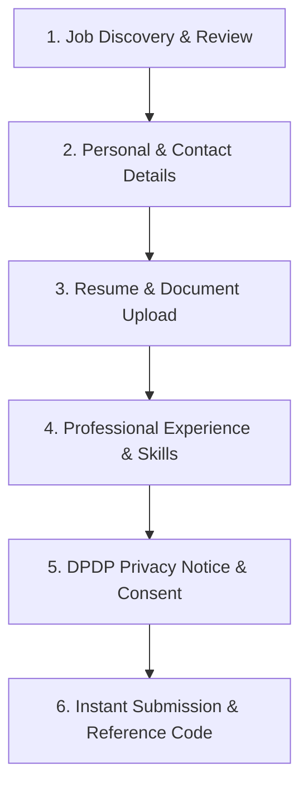

# Raptor v2.3 — Enterprise Recruitment Management Module (ATS)
## UI/UX 02. Public Career Portal & Candidate Application Experience

```
Document:             UI-UX/CAREERS-PORTAL-SPECIFICATION.md
Directory:            RAPTOR-V2.3-RECRUITMENT-BLUEPRINT/UI-UX/
Classification:       Public Careers Site, SEO Structured Data & Application Intake
Target Release:       Raptor v2.3
Route:                index.php?route=careers
```

---

## 1. Public Career Portal Architecture

The career portal is an unauthenticated, branded public front for job seekers. It is strictly segregated from internal administrative sessions while sharing the database:
- **Responsive Layout**: Designed for seamless mobile-first browsing on smartphones, tablets, and desktop displays.
- **Search & Filter Engine**: Instant client-side and AJAX filtering by Department, Location, Employment Type (Full-Time, Contract), and Workplace Arrangement (Remote, Hybrid, On-Site).
- **SEO & Google Jobs Integration**: Server-rendered HTML with Google structured data (`JobPosting` JSON-LD schema).

---

## 2. Structured Data Specification (JSON-LD `JobPosting`)

Every published job detail view dynamically embeds Google Jobs structured data:

```html
<script type="application/ld+json">
{
  "@context": "https://schema.org/",
  "@type": "JobPosting",
  "title": "Senior Backend PHP Engineer",
  "description": "<p>Raptor CRM is seeking an experienced Backend Engineer to lead our enterprise recruitment architecture...</p>",
  "identifier": {
    "@type": "PropertyValue",
    "name": "Raptor Technologies",
    "value": "REQ-2026-0042"
  },
  "datePosted": "2026-11-10",
  "validThrough": "2026-12-31T23:59:59",
  "employmentType": "FULL_TIME",
  "hiringOrganization": {
    "@type": "Organization",
    "name": "Raptor CRM",
    "sameAs": "https://raptorcrm.example.com",
    "logo": "https://raptorcrm.example.com/logo.png"
  },
  "jobLocation": {
    "@type": "Place",
    "address": {
      "@type": "PostalAddress",
      "addressLocality": "Hyderabad",
      "addressRegion": "Telangana",
      "addressCountry": "IN"
    }
  },
  "baseSalary": {
    "@type": "MonetaryAmount",
    "currency": "INR",
    "value": {
      "@type": "QuantitativeValue",
      "minValue": 1400000,
      "maxValue": 1800000,
      "unitText": "YEAR"
    }
  }
}
</script>
```

---

## 3. Candidate Application Wizard (Intake Flow)



### 3.1 Anti-Spam & Rate-Limiting Controls
- **Hidden Honeypot Field**: Form includes `<input type="text" name="company_url_hp" style="display:none" tabindex="-1">`. If populated, the submission is silently dropped as bot spam.
- **IP Rate Limiting**: Max 5 submissions per IP address per hour.
- **CSRF Token**: Single-use token embedded on the page.

### 3.2 Post-Submission Feedback
Upon successful submission:
1. Candidate is presented with a persistent success card showing their unique **Application Reference Code** (e.g. `APP-2026-00812`).
2. An automated acknowledgement email is queued and dispatched containing candidate portal tracking instructions.
